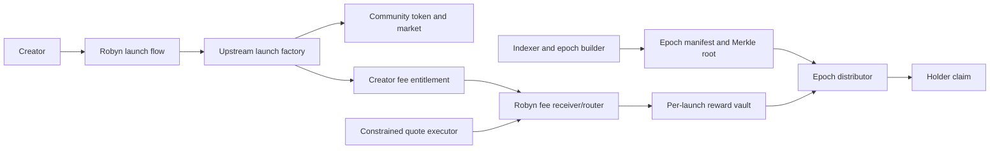

# Protocol, accounting and execution requirements

Status: Draft  
Owner: Protocol engineering TBD  
Date: 2026-07-20

## Purpose

Specify the minimum custom contract system needed to capture an upstream creator-fee share, preserve immutable basket weights, convert fees safely and make holder allocations claimable.

This is a requirements document, not a final Solidity design. Contract boundaries may change if the same invariants, permissions and verification surfaces remain intact.

## Architecture by release

### Adapter MVP

### Native release

Replace the upstream token/factory dependency and Merkle ownership calculation with a Robyn launch token that updates per-asset magnified correction state on every mint, burn and transfer. Fee conversion and pull claims remain isolated from trading.

The native release also adds the protocol-defined curve and graduation lifecycle in `research/17-bonding-curve-and-graduation-design.md`. The curve is a constant-product market with immutable parameters. Reaching its onchain threshold closes the curve and permits exactly one permissionless, irreversible migration into canonical locked liquidity. Both phases route the configured fee share to the same launch reward vault.

## Adapter components

| Component | Responsibility |
|---|---|
| `LaunchRegistry` | Canonical record of token, upstream factory, fee entitlement, basket, start block, exclusions and implementation versions |
| `FeeReceiver` | Receives or claims only the assigned creator-fee share and normalizes approved fee assets |
| `BasketRouter` | Maintains per-launch/per-leg pending balances, validates execution and deposits measured output |
| `RewardVault` | Segregates reward assets and authorizes only the corresponding distributor/execution path |
| `EpochDistributor` | Stores accepted roots/totals and pays proof-backed pull claims |
| `AssetRegistry` | Versioned approved assets, canonical status, feeds and execution policy |
| `ExecutionRegistry` | Allowed swap targets, spenders, selectors and quote policy |

Use minimal clones where appropriate. Do not introduce upgradeability by default. If a component must be upgradeable, isolate it from already-accrued holder funds and document proxy/admin behavior.

## Launch configuration

Each launch records:

- Robinhood Chain ID;
- community token and upstream launch factory;
- fee entitlement/receiver and start block;
- one to three reward-asset contract addresses;
- corresponding weights totaling 10,000 basis points;
- asset-registry version and execution policy version;
- eligible-supply exclusions;
- accounting mode and formula version;
- vault/distributor addresses;
- creator wallet and metadata/content hash;
- deployment transaction and configuration hash.

Basket address/weight arrays are immutable. Asset pause or delisting changes execution availability, not the promised address or weight.

## Fee lifecycle

1. Upstream protocol accrues the creator-fee share.
2. Permissionless or keeper-triggered claim transfers it to the Robyn fee receiver.
3. Receiver measures actual balance delta and normalizes native ETH to WETH when needed.
4. Router allocates the received amount to per-leg pending balances using immutable weights and carries rounding remainder.
5. A leg becomes executable only when threshold, route and safety policy pass.
6. Executor spends no more than that leg's pending amount and measures reward-token balance delta.
7. Acquired tokens enter the launch vault/controller and an immutable event records input, output, route and quote bounds.
8. Rewards become part of the next adapter epoch or native accumulator distribution.

## Protocol requirements

| ID | Requirement | Priority | Verification |
|---|---|---:|---|
| PROTO-001 | Launch basket MUST be immutable, unique by asset address and total exactly 10,000 bps | MUST | Unit/fuzz test |
| PROTO-002 | Fee allocation MUST conserve the received balance delta within bounded rounding dust | MUST | Stateful invariant |
| PROTO-003 | Pending funds MUST be isolated by launch and basket leg | MUST | Cross-launch isolation test |
| PROTO-004 | A failed conversion MUST preserve the same leg's pending principal | MUST | Revert/failure tests |
| PROTO-005 | Reward accrual MUST use measured token balance deltas, not router return values | MUST | Adversarial-token tests |
| PROTO-006 | Claims MUST be pull-based and MUST NOT execute arbitrary recipient code beyond safe token transfer behavior | MUST | Review and malicious receiver test |
| PROTO-007 | Keeper/operator MUST NOT choose arbitrary output token, receiver, spender or call target | MUST | Authorization/mutation tests |
| PROTO-008 | Anyone SHOULD be able to trigger a valid fee claim/conversion using an authorized quote | SHOULD | Permissionless trigger test |
| PROTO-009 | Core events MUST expose launch, fee receipt, leg allocation, conversion, deposit, root and claim data | MUST | ABI/event schema test |
| PROTO-010 | Contracts MUST use custom errors and explicit bounds for array length, weights, amounts and deadlines | MUST | Static/unit review |
| PROTO-011 | No component MAY sweep holder rewards to treasury or creator | MUST | Role and bytecode review |
| PROTO-012 | Contract versions and implementation/admin addresses MUST be publicly discoverable | MUST | Explorer/config audit |
| PROTO-013 | Curve progress MUST derive from canonical net reserve and immutable target, never gross volume or an offchain flag | MUST | Stateful invariant and API test |
| PROTO-014 | Graduation MUST be threshold-gated, permissionless, idempotent, atomic and irreversible | MUST | Unit/fuzz/adversarial tests |
| PROTO-015 | Graduation calldata MUST NOT permit arbitrary asset, pool, recipient, locker, router or fee-tier selection | MUST | Calldata mutation suite |
| PROTO-016 | Curve and graduated liquidity MUST have no privileged withdrawal path | MUST | Role/bytecode review |
| PROTO-017 | Pre-graduation transfers MUST be restricted to approved protocol flow; transfers become permanently permissionless after graduation | MUST | Transfer-state tests |
| PROTO-018 | Curve and post-graduation trading fees MUST remain bound to the launch's immutable basket vault | MUST | Cross-phase fee invariant |

## Adapter epoch calculation

For epoch `[startBlock, endBlock)` and each eligible wallet:

`balanceBlocks(wallet) = sum(balance held × blocks held)`

`allocation(wallet, asset) = distributable(asset) × balanceBlocks(wallet) / totalEligibleBalanceBlocks`

Requirements:

- Transfers at a block use a documented ordering derived from canonical transaction/log order.
- Excluded addresses contribute zero balance-blocks.
- Mint and burn events update eligible supply consistently.
- The final remainder policy is deterministic and cannot favor the builder/operator. Recommended: leave dust in the distributor for a future epoch.
- Reorganizations before finality invalidate unpublished work; published manifests bind block hashes.
- Multiple independent builders given identical inputs produce byte-identical ordered leaves, roots and totals.
- Roots have a challenge delay and may be rejected only for objective invalidity before finalization.

## Native accounting requirements

Native R3 uses one fixed accumulator slot per reward asset:

- high-precision cumulative reward per eligible token unit;
- per-account correction per asset;
- per-account withdrawn amount per asset;
- immutable excluded-address set or strictly constrained initialization process;
- settlement of sender/receiver correction on every transfer;
- `claim(asset)` and bounded `claimAll()`.

Required invariants:

- acquiring tokens after a distribution earns none of that prior distribution;
- selling preserves already accrued rewards;
- transfers do not change system-wide entitlement except bounded rounding;
- total claimed never exceeds total deposited;
- controller balance plus claimed plus explicitly reconciled exceptional loss covers total accrued;
- zero eligible supply holds new rewards pending;
- behavior is safe for 1, 3 and 5 configured slots, although MVP exposes at most 3.

## Execution requirements

| ID | Requirement | Priority | Verification |
|---|---|---:|---|
| EXEC-001 | Execution MUST use an approved exact input token, output token, receiver, spender, target and selector | MUST | Calldata mutation suite |
| EXEC-002 | Quote MUST have a deadline and nonzero minimum output | MUST | Expiry/min-out tests |
| EXEC-003 | Stock execution MUST validate canonical registry status and configured oracle policy immediately before execution | MUST for R2 | Fork tests |
| EXEC-004 | Price guard MUST read feed decimals, positive answer, freshness and sequencer/market policy | MUST for R2 | Stale/negative/down tests |
| EXEC-005 | Approval MUST be exact or safely scoped and cleared when required | MUST | Allowance tests |
| EXEC-006 | Each leg MUST execute independently so one failure does not block others | MUST | Partial-route test |
| EXEC-007 | Conversion MUST enforce both economic minimum and maximum pending delay policy | MUST | Keeper simulation |
| EXEC-008 | Quoted and actual output MUST be recorded and monitored for deviation | MUST | Event/reconciliation test |
| EXEC-009 | Direct AMM routes MUST be simulated at the intended block and remain subject to the same guards | MUST | Fork/manipulation test |
| EXEC-010 | No anonymous/discovery price MAY be treated as a firm executable quote | MUST | Integration review |

## Default economic policies to validate

- Minimum conversion per leg: greater of $50 equivalent or 10 times expected execution cost.
- Maximum normal delay: 24 hours once a liquid leg exceeds threshold.
- Initial maximum oracle deviation hypothesis: 100 bps for qualified liquid assets.
- Quote deadline: short enough to prevent stale execution; final value based on provider behavior.
- Epoch cadence: candidate weekly for early low volume.

These are configurable policy hypotheses, not immutable product decisions. Changes must not alter basket weights or redirect accrued funds.

## Reuse policy

- Import pinned OpenZeppelin primitives under their license.
- Use canonical Safe deployments for multisig administration.
- Use Alloy and Vladdy accounting behavior as references; do not deploy Alloy unchanged or copy unlicensed Vladdy source.
- Call the selected upstream factory through a pinned, verified ABI and monitored implementation.
- Do not depend on IndexPad, current Alloy, HoodETF or BASKET deployments for holder accounting.
