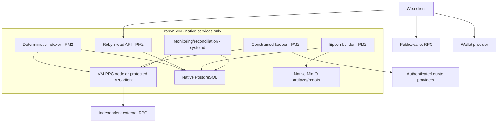

# Platform, data and infrastructure requirements

Status: Draft  
Owner: Platform engineering TBD  
Date: 2026-07-20

## Purpose

Define the web application, indexing, API, keeper, storage and RPC system required to make protocol state usable without turning Robyn's backend into a custody or correctness oracle.

## Logical architecture

## Client

Settled baseline: Next.js 15 App Router and React 19 with strict TypeScript, Tailwind CSS v4, repository-owned Radix/shadcn-derived components, viem, wagmi, WalletConnect/injected wallets, TanStack Query/Table, Zod and React Hook Form. Full dependency and repository boundaries are defined in [Technology stack and repository architecture](10-technology-stack-and-repository-architecture.md).

The client:

- reads connected-wallet balances and current transaction state from browser-direct RPC/wallet providers;
- reads discovery, history, charts, epoch data and proofs from the Robyn API;
- cross-checks correctness-critical current values against RPC before signature;
- caches immutable launch configuration;
- never receives provider, quote, keeper or signing secrets;
- can switch to a user-supplied RPC;
- exposes last indexed block and degraded state.

## Indexer

The API, indexer, keeper and epoch builder run as separate strict-TypeScript PM2 processes on the project VM with persistent `systemd` startup and saved PM2 state. Fastify serves HTTP; native PostgreSQL/Drizzle stores persistent canonical and derived data; native Redis/BullMQ provides retryable job coordination; native MinIO preserves content-addressed epoch artifacts.

All project-owned development, testing, CI, data and runtime processes execute on `robyn` at `192.168.50.250`. Docker and containers are prohibited. Native infrastructure services use `systemd`; the workstation is an SSH/control client only.

The indexer consumes:

- upstream token creation and fee-entitlement events;
- ERC-20 Transfer events for supported launches;
- Robyn launch, allocation, conversion, vault, epoch and claim events;
- upstream factory implementation/admin events;
- asset registry, feed and issuer-control events where available.

It stores raw canonical logs before derived state. Derived tables are rebuildable and versioned by formula/schema version.

### Reorganization policy

- Maintain observed head, safe/finalized head and last derived checkpoint separately.
- Do not finalize epochs using unfinalized blocks.
- Bind every epoch manifest to block numbers and hashes.
- On mismatch, roll back derived state to the last common checkpoint and replay.

## Data requirements

| ID | Requirement | Priority | Verification |
|---|---|---:|---|
| DATA-001 | Raw canonical events MUST be stored with chain, block hash/number, transaction hash/index and log index | MUST | Schema/integration test |
| DATA-002 | Derived balances and rewards MUST be reproducible solely from raw events and versioned configuration | MUST | Full rebuild comparison |
| DATA-003 | API responses with chain-derived values MUST expose `asOfBlock` and freshness | MUST | Contract/API test |
| DATA-004 | Epoch inputs, ordered leaves, totals, proofs and manifests MUST be content-addressed and immutable | MUST | Hash/retrieval test |
| DATA-005 | The API MUST NOT be required to submit a valid direct contract claim if the user has the proof | MUST | Offline claim script |
| DATA-006 | Indexing MUST be idempotent and safely restart from durable checkpoints | MUST | Kill/restart test |
| DATA-007 | Two independent rebuilds MUST produce byte-identical roots for the same epoch | MUST | Determinism test |
| DATA-008 | Data migrations MUST preserve a reproducible path for historical epoch versions | MUST | Migration rehearsal |
| DATA-009 | Discovery rankings and metrics MUST retain formula version and source fields | MUST | Analytics audit |
| DATA-010 | Personally identifying offchain data SHOULD be avoided; wallet addresses are public identifiers, not verified identities | SHOULD | Privacy review |

## API surface

Minimum read endpoints:

- `GET /launches` with filters and cursor pagination.
- `GET /launches/{token}` canonical detail/configuration.
- `GET /launches/{token}/activity` fee/conversion/epoch/claim timeline.
- `GET /launches/{token}/rewards/{wallet}` pending/finalized/claimable detail.
- `GET /epochs/{chain}/{distributor}/{epoch}` manifest and state.
- `GET /epochs/{...}/proof/{wallet}` deterministic claim proof.
- `GET /assets` approved asset registry with route/feed status.
- `GET /status` indexer, RPC, keeper and route health.

Write endpoints are limited to authenticated operational workflows that cannot move funds directly, such as quote request orchestration or root-candidate publication. User transactions are signed in the wallet.

## Keeper

The keeper:

During R0, browser and application development use the VM-hosted Robyn Devnet: native Anvil chain ID `31337`, loopback raw RPC, restricted LAN RPC gateway and an abuse-controlled faucet. Automated suites use isolated ephemeral Anvil processes rather than mutating the persistent shared devnet. Devnet-only wallets, keys, faucet routes and configuration cannot enter testnet or production bundles.

- observes per-leg thresholds;
- obtains authenticated quotes;
- validates provider response against local policy;
- simulates exact calldata at the latest safe block;
- submits only constrained protocol calls;
- records attempts, errors, receipts and balance reconciliation;
- has no withdrawal, arbitrary call, basket-edit or root-finalization authority;
- is replaceable without affecting holder entitlement.

Permissionless public triggering is preferred where valid quote data can be safely supplied onchain.

## RPC strategy

| Workload | Primary | Fallback |
|---|---|---|
| Wallet balance/current reads | Public RPC from browser | Wallet or user-supplied RPC |
| Transaction submission | Wallet-configured/public RPC | Wallet provider fallback |
| Discovery/history | Robyn API/database | Stale cache with freshness warning |
| Complete event ingestion | VM-hosted RPC/archive node when supported, otherwise protected external provider | Independent external provider |
| Epoch construction | Primary path plus block-hash cross-check | Independent replay provider |
| Keeper simulation/submission | VM node or protected provider | Independent provider |
| Monitoring | Primary plus independent external provider | Explorer API for diagnosis only |
| INFRA-015 | R0 MUST provide a native VM-hosted Anvil devnet on chain ID 31337 with persistent state, loopback raw RPC, restricted user RPC, controlled faucet funding and isolated ephemeral test chains; privileged dev methods and dev-only credentials MUST be absent from testnet/production builds | MUST | RPC allow/deny, persistence, faucet-abuse, isolation and bundle-scan tests |

Public RPC rate limiting may aggregate users behind a corporate network, VPN or carrier NAT. Client backoff uses jitter, request coalescing and moderate polling. Never silently route all reads through a secret backend endpoint.

If Robinhood publishes a supported node distribution and Robyn needs to operate its own RPC/archive service, it MUST be installed natively on this VM under `systemd` after CPU, memory, storage, IOPS and bandwidth sizing. The independent correctness path remains external so a single VM or client cannot certify itself.

## Infrastructure requirements

| ID | Requirement | Priority | Verification |
|---|---|---:|---|
| INFRA-001 | Provider and quote secrets MUST remain server-side in root-controlled VM secret files or systemd credentials scoped per service | MUST | Build/deployment/permission scan |
| INFRA-002 | Production MUST use at least two independent RPC paths for correctness checks | MUST | Failure drill |
| INFRA-003 | Routine user reads SHOULD avoid project-paid RPC | SHOULD | Traffic/cost measurement |
| INFRA-004 | Critical jobs MUST have idempotency keys, bounded retries and dead-letter visibility | MUST | Chaos test |
| INFRA-005 | Deployments MUST be reproducible from pinned dependencies and published configuration | MUST | Clean build/deploy rehearsal |
| INFRA-006 | Contract addresses, bytecode hashes, proxy implementations and roles MUST be recorded per environment | MUST | Deployment manifest audit |
| INFRA-007 | Logs MUST exclude secrets and minimize wallet-correlated request metadata | MUST | Logging/privacy review |
| INFRA-008 | Backups MUST cover raw logs, database, manifests and configuration; restore MUST be rehearsed | MUST | Restore test |
| INFRA-009 | The system MUST expose health separately for web, API, indexer, epoch builder, keeper, RPC and quote routes | MUST | Observability test |
| INFRA-010 | Production changes MUST use staged deployment and rollback/runbook evidence | MUST | Release rehearsal |
| INFRA-011 | All project builds, tests, CI jobs, data stores, services and deployments MUST execute on the `robyn` VM; the workstation MUST remain control-only | MUST | Environment/process audit |
| INFRA-012 | Project infrastructure MUST NOT use Docker, containers, Kubernetes or container registries | MUST | Package/config/process audit |
| INFRA-013 | Node applications MUST persist through PM2 plus systemd startup and saved state; native infrastructure services MUST use enabled systemd units | MUST | Reboot/recovery test |
| INFRA-014 | Any project-operated RPC node MUST run natively on the VM with documented capacity and an independent external verification path | MUST | Node/service/divergence test |

## Service targets for beta

| Metric | Target |
|---|---|
| Cached public page API availability | 99.5% monthly |
| Indexer lag in normal operation | p95 under 60 seconds |
| Transaction state refresh after confirmation | p95 under 30 seconds |
| Epoch proof availability after finalization | p95 under 5 minutes |
| Critical alert acknowledgement | under 15 minutes during supported beta hours |
| Deterministic restore from checkpoint | under 4 hours |

These are beta targets, not externally promised SLAs.

## Environments

- VM R0: deterministic chain or fork plus mocks, using native VM services and isolated test namespaces.
- Robinhood testnet: project mock assets, mock feeds and issuer-control token.
- Mainnet fork: exact upstream/proxy/exchange integration tests.
- Mainnet validation: dedicated low-value wallet and contracts, not public.
- Mainnet beta: capped product exposure after audit and gates.

No mainnet private key is stored in repository files, PM2 configuration or general CI environment variables. Production operational actions use Safe or scoped managed signing.
