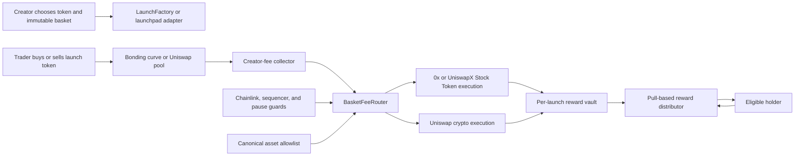

# Product feasibility and technical architecture

Last verified: 2026-07-20

## Feasibility verdict

| Requirement | Verdict | Important condition |
|---|---|---|
| Anyone can deploy a launch token | Yes | Robinhood Chain is permissionless and EVM-compatible |
| Creator fixes basket weights at launch | Yes | Validate canonical addresses and require weights to total 10,000 basis points |
| Capture creator trading fees | Yes | Build a native launchpad or use an existing protocol that accepts a smart-contract fee recipient |
| Buy Stock Tokens with the fee stream | Yes, with integration work | Stock liquidity is RFQ and intent-driven; 0x or UniswapX quotes and an executor are needed |
| Buy crypto and memecoins | Yes | Use curated Uniswap routes and reject unsafe or illiquid assets |
| Distribute value to every holder | Yes | Use pull-based claims or transfer-aware accounting; never loop through all holders in one transaction |
| Make the launch token itself “backed” | Yes, but it is a different product | Requires enforceable redemption and overlaps Vimen's model |
| Offer arbitrary familiar stocks | No | Only assets in Robinhood's current canonical registry are available |
| Offer Stock Token rewards globally | No | RHJ securities restrictions and local law limit eligible users and jurisdictions |

## Recommended product definition

The recommended version is a **fee-funded basket reward layer**:

- A creator launches a normal community token.
- The creator chooses one to five allowlisted reward assets and immutable weights.
- A defined percentage of the creator fee stream enters a fee router.
- The router periodically converts WETH or USDG into the chosen assets.
- Holders accrue a claim on the purchased reward assets.
- The launch token remains freely traded and is not redeemable for the reward vault's entire inventory unless that feature is deliberately added.

Example configuration:

| Asset | Weight | Current feasibility |
|---|---:|---|
| `NVDA` Robinhood Stock Token | 40% | Supported |
| Block / Cash App (`XYZ`) | 40% | Unsupported until the canonical registry adds it |
| `SPY` Robinhood Stock Token | 20% | Supported |

The UI should block this exact configuration today and offer a supported replacement for `XYZ`, not silently map it to an unrelated token.

## Do not blur these product models

### Model A: reward stream

Trading fees buy assets. Holders claim rewards based on ownership over time. The launch token is **reward-bearing**, not backed. Its market price can be unrelated to the accumulated rewards.

Advantages:

- Closest to the original chat request.
- Can sit on top of pons, Bags, or another launchpad.
- No need to let users redeem the launch token's principal.
- Clear differentiation from Vimen.

Disadvantages:

- Reward accounting is harder than sending fees to one creator wallet.
- It still creates substantial securities and distribution questions.
- Small fee streams may be uneconomic to swap into several assets.

### Model B: redeemable basket

The token is a vault receipt. A holder burns it to receive a proportional share of the underlying assets.

Advantages:

- “Backed” has a precise, provable meaning.
- Net asset value can be calculated from balances and Chainlink feeds.
- Redemptions create an arbitrage mechanism around NAV.

Disadvantages:

- Directly overlaps Vimen.
- Requires mint, burn, and in-kind redemption logic.
- Inherits every underlying issuer pause and redemption risk.
- Carries the strongest regulated investment-product characteristics.

## Fastest implementation paths

Reuse audit update, 2026-07-20: Alloy has published MIT-licensed Robinhood Chain contracts for a one-Stock-Token version of the fee-funded holder-reward model. Its magnified transfer-correction accounting is the best source-code starting point for a native Robyn token, but its current launchpad is not safe to deploy unchanged. It lacks weighted multi-asset baskets, uses an MEV-exposed zero-minimum-output swap, accepts arbitrary reward addresses at contract level, and has no publicly verifiable audit report. See [Reusable contracts and infrastructure](11-reusable-contracts-and-infrastructure.md).

### Path 1: launchpad adapter

Use an existing launchpad for token creation and liquidity. Register a `BasketFeeRouter` as the creator fee wallet or fee claimer.

Best candidates:

- **Bags:** the docs explicitly support multiple fee claimers and a partner fee path. Creator fees accrue as WETH in a per-token `BagsFeeShare` contract.
- **pons:** the creator sets the fee wallet at creation. A contract recipient appears plausible, but claim automation and both-token fee handling need a fork test.

Advantages: fastest time to a real fee stream, no new AMM, no liquidity locker, existing discovery and trading surfaces.

Limitations: no custom transfer hook on the launch token, dependence on a third-party factory, and possible restrictions on fee redirects or claims.

Recommended reward accounting for this path: fixed epochs with holder checkpoints and pull claims. If the existing token does not expose historical checkpoints, reconstruct balances from `Transfer` events and publish a Merkle root for each epoch. Add a delay and a public verification tool so a bad root can be challenged before claims open.

### Path 2: native launchpad

Deploy a launch factory, custom reward-aware token, curve or direct pool, liquidity locker, fee router, and reward distributor.

Advantages: exact economics, transfer-aware reward accounting, native dashboard, immutable basket configuration, and no dependence on another launchpad's payout behavior.

Limitations: larger audit surface, liquidity bootstrapping, indexer work, and harder creator acquisition.

Recommended reward accounting for this path: cumulative reward-per-share accounting integrated into token transfers. Every transfer settles the sender and recipient against the current cumulative index. This produces ownership-time-weighted accrual without iterating over holders or relying on a single snapshot block.

## Recommended system design

### `LaunchFactory` or adapter registry

Responsibilities:

- Create a launch or register an existing launchpad token.
- Deploy a minimal per-launch basket vault and distributor.
- Store the launchpad source, token, pool, fee contract, basket configuration, and reward exclusions.
- Emit a single canonical creation event for indexers.

### `BasketConfig`

Store the basket at launch and make it immutable unless the product explicitly implements a governed replacement process for delisted or paused assets.

Required checks:

- One to five reward assets for the first release.
- Unique addresses only.
- Weights total exactly 10,000 basis points.
- Every Stock Token address must match Robinhood's canonical registry response.
- Every crypto token must be on a curated allowlist with a verified route and minimum liquidity.
- Reject the launch token itself as a reward asset in the first release.
- Record whether an asset is a Stock Token, stablecoin, major crypto, or high-risk community token.

Immutability creates a problem when an asset is delisted, paused, or loses liquidity. The safest initial rule is: purchases for a failed asset accumulate in WETH or USDG for that weight until the asset is restored. Do not silently redirect its weight to another asset.

### `BasketFeeRouter`

Responsibilities:

- Receive or claim creator fees.
- Normalize native ETH to WETH.
- Handle launch-token-side LP fees according to a published policy, such as burn them or sell them subject to a strict impact limit.
- Accumulate below a per-asset minimum to avoid uneconomic dust swaps.
- Split a harvest amount by immutable weights.
- Validate an externally supplied quote against oracle and slippage rules.
- Execute each asset leg separately so one unavailable asset does not block the others.
- Send acquired assets to the per-launch reward vault.

The router should never have an unrestricted arbitrary-call function. Limit callable settlement contracts, token approvals, and selectors through an allowlist and timelocked governance.

### Stock Token execution

Stock Tokens are ERC-20s, but their main liquidity is not equivalent to a deep ordinary AMM pool. Robinhood and 0x describe RFQ liquidity; Uniswap also supports Stock Tokens through UniswapX intent routes and AMMs.

Recommended flow:

1. A permissioned or decentralized keeper requests a firm 0x or UniswapX quote for WETH or USDG into the exact Stock Token.
2. The router verifies the sell token, buy token, amount, expiry, settlement contract, and minimum output.
3. `OracleGuard` compares quote value with the Chainlink feed and rejects excessive deviation.
4. The router checks sequencer uptime, feed staleness, and `oraclePaused()`.
5. The router executes and records actual spend and received amount.

This is automated but not purely autonomous: an offchain actor must obtain and submit the signed quote. Anyone may be allowed to submit a valid quote if the onchain checks are sufficient.

### Crypto and memecoin execution

Use Uniswap v2/v3/v4 routes only through known routers. Major assets can use direct pools or an aggregator. Community tokens require stricter controls:

- Minimum time since deployment.
- Verified, non-upgradeable or reviewed code.
- No transfer tax, blacklist, honeypot, or balance-changing behavior.
- Minimum locked liquidity and maximum price impact.
- No owner mint authority unless explicitly approved.
- Chainlink or robust TWAP protection where available.

An arbitrary-address selector would make the launchpad a tool for directing fee flows into malicious or creator-controlled tokens. A curated allowlist is a core safety feature, not an optional moderation policy.

### `OracleGuard`

For every Stock Token purchase:

- Require a positive Chainlink price.
- Read the feed's decimals instead of hardcoding eight.
- Enforce its published heartbeat.
- Require the L2 sequencer to be up and beyond a recovery grace period.
- Reject while the token reports `oraclePaused()`.
- Use the feed price directly because it already incorporates `uiMultiplier()`.
- Pause automated execution when the 24/5 stock feed is outside its update schedule or stale.

### `RewardDistributor`

Never push rewards to every holder. Holder count is unbounded and a single transfer to a reverting contract can block the entire operation.

Preferred native-token design:

- Maintain `magnifiedRewardPerShare[rewardAsset]`.
- Settle sender and receiver reward corrections on every launch-token transfer.
- Exclude the pool, locker, burn address, distributor, treasury, and other non-beneficial system accounts.
- Let each holder claim one asset or all assets.
- Allow sponsored claims through ERC-4337.
- Cap the number of basket assets so transfer settlement remains bounded.

Preferred adapter design:

- Divide time into epochs.
- Reconstruct balances and ownership duration from onchain events.
- Publish an auditable Merkle root and total per asset.
- Open claims after a challenge delay.
- Carry unclaimed amounts forward only under a disclosed policy.

A single snapshot block is not recommended because a trader can buy immediately before the snapshot, claim rewards generated by earlier holders, and sell after it.

## Suggested contract set

| Contract | Upgrade policy | Purpose |
|---|---|---|
| `LaunchFactory` | Timelocked upgrade for beta, then freeze or version | Deploy and register launches |
| `BasketConfigRegistry` | Immutable per launch | Canonical assets, weights, and failure policy |
| `BasketFeeRouter` | Versioned implementation with restricted settlement adapters | Claim, split, quote-check, and swap fees |
| `OracleGuard` | Replaceable feed registry through timelock | Staleness, sequencer, multiplier, and pause checks |
| `RewardVault` | Minimal immutable clone | Custody reward assets for one launch |
| `RewardDistributor` | Minimal immutable clone or token-integrated logic | Accrual and pull claims |
| `LaunchToken` | Immutable | Fixed supply and reward-accounting hook for native launches |
| `LiquidityLocker` | Immutable | Lock LP while retaining fee collection |

## Data and user experience

The front end needs more than a token page. It should show:

- Basket weights and the immutable configuration transaction.
- Supported versus temporarily unavailable assets.
- Creator fees collected by source token.
- Every harvest transaction and execution price.
- Cumulative assets purchased.
- Current vault balances.
- Claimable amount per holder and reward asset.
- Oracle freshness and corporate-action pause state.
- The distinction between token market capitalization and accumulated rewards.
- Non-blocking issuer and jurisdiction notices before Stock Token interaction.

Index from contract events rather than treating a private database as authoritative. Use a production RPC or archive provider because Robinhood warns that its public RPC is rate-limited and wide log queries may time out.

## MVP scope

### Phase 0: testnet proof

- One launch token.
- Three mock reward assets.
- Immutable weights.
- Synthetic fee deposits.
- Transfer-aware reward accounting.
- Keeper-driven harvest.
- Claims and exclusions.
- Property tests for conservation and transfer timing.

### Phase 1: crypto-only mainnet pilot

- Integrate one existing launchpad, preferably Bags or pons after compatibility testing.
- Allow only WETH, USDG, and two or three deep-liquidity crypto assets.
- Maximum three assets per basket.
- Minimum harvest threshold and bounded slippage.
- Public beta cap per launch.
- Audit before removing caps.

### Phase 2: Stock Token beta

- Keep contracts permissionless with no project-operated KYC, geoblocking, wallet allowlist, or onchain eligibility gate under the current product decision.
- Display accurate, non-blocking issuer and jurisdiction disclosures.
- Add canonical registry synchronization.
- Add 0x or UniswapX RFQ execution.
- Add Chainlink staleness, sequencer, and corporate-action pause checks.
- Begin with `NVDA`, `SPY`, and a small set of liquid assets, not all 96 registry entries.
- Add per-asset and per-launch exposure caps.

### Phase 3: native launchpad

- Custom reward-aware ERC-20.
- Atomic token and pool creation.
- Immutable liquidity locker.
- Built-in creator, protocol, and holder fee splits.
- Gas-sponsored onboarding and claims.
- Partner and referral APIs.

## Build estimate by workstream

This is a sizing guide, not a delivery commitment.

| Workstream | Relative effort | Main uncertainty |
|---|---:|---|
| Testnet reward-accounting proof | Medium | Correct transfer-time accounting |
| Existing launchpad adapter | Medium | Contract fee-recipient compatibility |
| Stock RFQ executor | Medium-high | Quote access, settlement rules, and reliability |
| Production indexer and dashboard | Medium-high | Reorg handling and subgraph/RPC performance |
| Native factory, pool, and locker | High | Security and liquidity mechanics |
| Optional future compliance layer | Out of current scope | Revisit only if the product access policy changes |
| Audit and adversarial testing | High | Cross-protocol and accounting attack surface |

## Go or no-go

**Go** for a technical prototype and a crypto-only adapter pilot.

**Conditional go** for Stock Token rewards after executable RFQ access, oracle safeguards, accounting verification, and audit readiness. Under the current product decision, legal review proceeds in parallel and active user-eligibility enforcement is not an implementation gate.

**No-go** for marketing the initial token as “backed” without an audited, permissionless redemption right.
