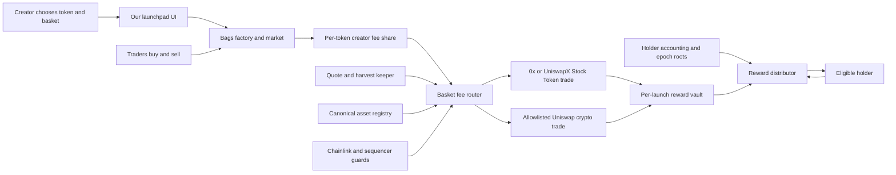

# Launchpad product blueprint and build requirements

Last verified: 2026-07-20

## Executive recommendation

Build the first release as a branded launchpad interface backed by an existing Robinhood Chain launch protocol, preferably Bags. To the creator and trader it looks like one product. Internally, Bags creates the token, market, and locked liquidity, while our contracts receive the creator-fee share, buy the creator's fixed basket, and let holders claim their accrued assets.

Reuse audit update, 2026-07-20: [Alloy's MIT-licensed contracts](https://github.com/AlloyRH/AlloyFund) already implement the single-reward-asset, transfer-aware holder accounting that a native Robyn token needs. This creates two legitimate MVP routes. Bags remains the fastest market adapter but requires indexed, time-weighted Merkle reward epochs because its token has no Robyn transfer hook. A selective Alloy fork requires more launch-contract work but gives fully on-chain accrual and more closely matches the holder promise. The detailed build-versus-reuse decision is in [Reusable contracts and infrastructure](11-reusable-contracts-and-infrastructure.md).

The product should initially be described as a **fee-funded basket reward token**, not a backed token. Trading fees buy the basket after launch. The launch token is not redeemable for a fixed share of assets deposited at creation.

The recommended default rules are:

- 100% of the upstream creator-fee share goes to the holder basket.
- The protocol's upstream fee remains separate.
- A basket contains one to three allowlisted assets at launch.
- Asset addresses and weights are immutable and total exactly 100%.
- Rewards are harvested in batches, not on every trade.
- Holders claim rewards themselves; the protocol never loops over every holder.
- The initial implementation assumes users are eligible non-U.S. persons and does not add KYC, geoblocking, wallet allowlists, or an onchain eligibility gate.

## What the product looks like

### 1. Discover page

The home page shows launches ranked by real activity, not promised yield:

- Token name, symbol, image, market capitalization, liquidity, and trading volume.
- Basket assets and weights.
- Creator fees collected and cumulative value converted into rewards.
- Reward vault balance and number of successful harvests.
- Stock Token risk disclosure and current asset availability.
- Links to the token, pool, basket configuration, vault, and harvest transactions.

### 2. Create flow

The creator completes a short launch wizard:

1. **Token:** name, symbol, image, description, social links, and optional initial buy.
2. **Basket:** choose one to three assets from the canonical allowlist.
3. **Weights:** assign integer basis-point weights totaling 10,000.
4. **Rules:** review the creator-fee percentage, harvest threshold, failed-asset policy, reward exclusions, and jurisdiction warning.
5. **Preview:** see an example of how a fee amount would be split.
6. **Launch:** sign one batched transaction or a short transaction sequence.

The selector must use canonical contract addresses. It must not accept a ticker typed by the creator. For example, `NVDA` and `SPY` are currently valid, while Block/Cash App (`XYZ`) is not in Robinhood's registry and must be rejected.

Example supported basket:

| Asset | Weight |
|---|---:|
| NVIDIA Stock Token (`NVDA`) | 40% |
| Apple Stock Token (`AAPL`) | 40% |
| S&P 500 exposure (`SPY`) | 20% |

### 3. Launch confirmation

Before signing, the creator sees permanent terms:

- Exact token and reward-asset contract addresses.
- Exact weights and confirmation that they cannot be edited.
- Which launchpad factory and fee-share contracts are being used.
- Percentage of trading fees going to the basket, creator, and protocol.
- What happens if an asset is paused, delisted, stale, or illiquid.
- Clear statement that rewards depend on future trading fees and can be zero.

### 4. Token page

The token page combines trading and reward transparency:

- Buy and sell interface or deep link to the trading venue.
- Price, market capitalization, liquidity, holder count, and volume.
- Basket composition.
- Fee flow since launch.
- Latest and cumulative purchases for each basket asset.
- Vault balances.
- The connected wallet's accrued and claimable rewards.
- Claim button for one asset or all assets.
- Oracle, quote, and Stock Token pause status.
- A visible distinction between the launch token's market value and the reward vault's assets.

### 5. Portfolio page

A holder sees all owned launch tokens, unclaimed rewards by asset, and claim history. Claims can later be sponsored with account abstraction so a holder does not need ETH for gas.

## How the money moves

For a Bags-based first release, the flow is:

If $10,000 of trading volume produces $100 of creator fees for the basket, a 40/40/20 configuration allocates $40, $40, and $20 before execution costs. The router waits until each leg meets its minimum economic size, obtains valid quotes, and executes each leg independently.

If a basket asset cannot be purchased, its allocation remains in WETH or USDG for a later attempt. It is not silently redirected to the other assets.

## Required smart contracts

### Adapter MVP

| Component | Requirement |
|---|---|
| `LaunchRegistry` | Records each supported token, upstream factory, fee-share contract, basket, start block, and distributor version. |
| `BasketConfig` | Stores one to three unique canonical asset addresses and immutable weights totaling 10,000 basis points. |
| `BasketFeeRouter` | Claims fees, wraps ETH, splits harvests, verifies quotes, executes allowlisted swaps, and sends output to the vault. |
| `OracleGuard` | Checks price positivity, heartbeat, sequencer status, recovery delay, quote deviation, and Stock Token oracle pause state. |
| `RewardVault` | Minimal per-launch custody contract that cannot redirect holder assets to an administrator. |
| `EpochDistributor` | Verifies Merkle proofs and pays each holder's allocation once per epoch and reward asset. |
| `EligibilityVerifier` | Not included in the current implementation; preserve an optional extension point if policy changes later. |

Because a Bags token was not designed with our accounting hooks, the adapter uses time-bounded reward epochs. An indexer reconstructs balances and ownership duration from `Transfer` events, calculates each wallet's share, and publishes a Merkle root. A challenge delay and a public proof-generation tool are needed before claims open.

### Native launchpad later

A fully native product adds:

| Component | Requirement |
|---|---|
| `LaunchFactory` | Atomically deploys the launch token, basket vault, distributor, market, and locked liquidity. |
| `LaunchToken` | Fixed-supply ERC-20 with transfer-aware cumulative reward accounting. |
| `Market` | A bonding curve or direct Uniswap v4 market with defined graduation rules. |
| `LiquidityLocker` | Permanently or time-locks liquidity while preserving the agreed fee flow. |
| `FeeSplitter` | Enforces basket, protocol, creator, and optional referral shares onchain. |

The native token can settle rewards for sender and receiver on every transfer. This avoids offchain Merkle accounting, but the custom token, market, and locker substantially increase the audit surface.

## Required offchain services

The contracts alone are not a complete product.

### Web application

- Creator launch wizard.
- Asset catalog synchronized from Robinhood's official registry.
- Token discovery and detail pages.
- Embedded trading or safe venue links.
- Reward and claim dashboard.
- Wallet, chain-switching, and transaction simulation.
- Non-blocking issuer and jurisdiction notices.
- Direct browser reads through Robinhood's public RPC so normal user traffic does not consume a project RPC quota.
- Wallet-submitted transactions through the connected wallet's EIP-1193 provider.
- Optional custom RPC setting and a low-volume fallback endpoint when the public RPC is unavailable or throttled.

### Event indexer

- Ingest launch, fee, transfer, harvest, vault, and claim events.
- Reconstruct holder balances and ownership duration for adapter epochs.
- Handle reorganizations and resume from checkpoints.
- Serve charts, portfolio views, and proof data.
- Use a production or archive RPC rather than Robinhood's rate-limited public RPC for wide historical queries.

### Quote and harvest keeper

- Monitor fee balances and minimum harvest thresholds.
- Request firm Stock Token quotes from 0x or UniswapX.
- Find allowlisted crypto routes through Uniswap.
- Submit only quotes that satisfy onchain expiry, minimum-output, oracle, pause, and slippage checks.
- Retry failed basket legs independently.
- Support multiple keepers so one operator cannot censor every harvest.

### Application API and database

- Cache asset metadata and application views.
- Store indexed, reproducible event data and epoch calculations.
- Produce Merkle proofs for claim transactions.
- Never be the authority for basket weights, vault ownership, or paid-claim state; those remain onchain.

### Monitoring and operations

- Watch issuer pauses, registry removal, beacon upgrades, oracle staleness, sequencer status, quote failures, unusual slippage, vault conservation, and keeper health.
- Maintain a public status page and incident runbook.
- Operate contract administration through a hardware-backed multisig and public timelock.

## Required integrations

| Integration | Why it is needed |
|---|---|
| Robinhood Chain RPC and explorer | Transactions, logs, verification, and user links. |
| Robinhood RHJ asset registry | Canonical Stock Token names and contract addresses. |
| Bags contracts | Token creation, initial market, liquidity, and creator-fee source for the recommended MVP. |
| 0x or UniswapX | Firm or intent-based execution into Stock Tokens. |
| Uniswap routers | WETH, USDG, and approved crypto execution. |
| Chainlink feeds | Stock price, quote-deviation, and sequencer safety checks. |
| Production RPC or indexer provider | Reliable historical event ingestion. |
| Wallet and account-abstraction provider | Embedded onboarding, transaction batching, and later sponsored claims. |

## Minimal-RPC-cost strategy

Use Robinhood's public mainnet endpoint, `https://rpc.mainnet.chain.robinhood.com`, directly from the browser as the primary read transport. Its current CORS preflight permits browser `POST` requests. This distributes ordinary read traffic across user connections and avoids paying to proxy every `eth_call`, balance read, simulation, or transaction broadcast through project infrastructure.

The public endpoint should handle the normal per-user path:

- Chain ID, block number, native and ERC-20 balances.
- Basket configuration, vault balances, and onchain claimable values.
- Allowances, quote validation previews, and gas estimation.
- Recent events over small block ranges.
- Transaction broadcast through the wallet or public endpoint.

Keep the client efficient:

- Batch compatible reads through Multicall rather than issuing many separate requests.
- Cache immutable launch configuration locally and in the application API.
- Poll visible pages at a moderate interval and stop polling when the tab is hidden.
- Query logs only over narrow ranges and never rescan launch history in each browser.
- Deduplicate identical requests made by multiple components in the same page.
- Let advanced users provide their own RPC URL.

Do not assume the public endpoint's undocumented rate-limit key is always one unique user IP. Corporate networks, mobile carriers, VPNs, and shared gateways can place many users behind one address, and Robinhood can change or discontinue the service. The UI therefore needs retry with jitter, clear degraded-state messaging, and at least one fallback transport. It must not retry aggressively into a rate limit.

Only protocol-owned workloads need a shared reliable RPC:

| Workload | Why public per-user RPC is insufficient |
|---|---|
| Transfer-event indexer | Must continuously ingest a complete canonical history even when no user has the site open. |
| Merkle epoch builder | Must reproduce every holder's time-weighted balance from complete logs. |
| Harvest keeper | Must reliably read fee balances, simulate settlement, submit quotes, and confirm transactions. |
| Monitoring | Must detect pauses, stale feeds, failed harvests, and accounting mismatches without depending on browser sessions. |

For the early beta, one free-tier or low-volume archive-capable provider can serve those backend workloads. Store indexed results in PostgreSQL, advance from durable block checkpoints, and expose the derived data through the application API. User browsers should read charts, discovery lists, holder history, and Merkle proofs from that database rather than independently replaying chain history.

The fallback endpoint must not be embedded as an unrestricted secret API key in browser JavaScript. If a keyed provider is needed, either use a provider key explicitly designed for public origin-restricted use or place a tightly rate-limited method allowlist in front of it.

Robinhood labels its public RPC as rate-limited and not intended for production-grade, high-throughput, or latency-sensitive use. The design therefore uses it as the default decentralized client transport, not as the sole dependency for correctness-critical protocol automation.

## Functional requirements for version one

1. A creator can launch or register one token through the supported upstream launchpad.
2. The creator selects one to three allowlisted reward assets.
3. Weights total exactly 100% and cannot be changed after launch.
4. The creator-fee recipient is the basket system, not an externally controlled wallet.
5. Anyone can verify the fee source, basket, vault balances, harvests, roots, and claims onchain.
6. Fees below the minimum threshold accumulate safely.
7. One failed asset leg does not block successful asset legs.
8. A holder's entitlement reflects both balance and ownership time, not one snapshot block.
9. Claims are pull-based and cannot be replayed.
10. Excluded balances such as pools, lockers, burn addresses, and system contracts do not earn rewards.
11. The interface distinguishes accrued, claimable, claimed, pending-swap, and temporarily unavailable amounts.
12. No administrator can replace a launch's assets, edit its weights, or withdraw holder rewards.

## Security requirements

- No unrestricted arbitrary calls from the router.
- Allowlisted settlement contracts, routers, tokens, and function selectors.
- Exact or short-lived token approvals.
- Quote deadlines, minimum outputs, oracle deviation caps, and per-harvest limits.
- Reentrancy protection and checks-effects-interactions on claims.
- Conservation invariant: funded equals claimed plus claimable plus undistributed, within documented rounding dust.
- Transfer, mint, burn, exclusion, and epoch-boundary property tests.
- Verified source code, independent audit, beta caps, and bug bounty before an uncapped release.
- Timelocked, narrow emergency controls that cannot seize vault assets or rewrite baskets.

## Current access policy and legal risk

Robinhood Stock Tokens are tokenized debt securities, not wrapped shares. Technical transferability does not make them lawful to deliver to every wallet.

The current product decision is to treat users as eligible non-U.S. persons without actively verifying or restricting them. Therefore the initial implementation has:

- No KYC or KYB flow.
- No IP geoblocking.
- No wallet allowlist or denylist maintained by the protocol.
- No onchain eligibility credential on launch, trading, harvest, or claim functions.
- No eligibility attestation that blocks a transaction.
- Permissionless contracts that any wallet can call.

The interface should still display accurate, non-blocking disclosures that Stock Tokens are tokenized debt securities, are not direct shares, and are subject to issuer restrictions. This policy removes eligibility controls from the engineering scope; it does not change the issuer's terms or determine the project's legal obligations. Counsel, entity structure, terms, privacy, tax, and operating-jurisdiction work remain advisable in parallel and should not be misrepresented as solved.

## Recommended release sequence

### Stage 0: integration spike

- Verify Bags can assign the basket router as a fee claimer.
- Verify fees can be claimed by a contract and forwarded without an EOA-only assumption.
- Confirm exact mainnet factory, fee-share, pool, and router versions.
- Confirm executable quote access for a small set of Stock Tokens.

### Stage 1: testnet proof

- Deploy one test token and three mock assets.
- Use Robinhood Chain Testnet, chain ID `46630`, through `https://rpc.testnet.chain.robinhood.com`; see the verified [testnet development details](01-chain-and-assets.md#testnet-development-details).
- Confirm a test-ETH funding route before scheduling deployment. No official public faucet was located in the current Robinhood documentation.
- Do not reuse mainnet Stock Token addresses. Deploy mock ERC-20s, mock Chainlink-style feeds, and a mock issuer-controlled token because no canonical testnet Stock Token registry was located.
- Generate synthetic fee deposits.
- Implement immutable weights, harvests, vaults, epochs, proofs, exclusions, and claims.
- Fuzz conservation, transfers, timing, and replay protection.
- Build the launch wizard and token/reward page.

### Stage 2: crypto-only capped pilot

- Launch through Bags with WETH, USDG, and a small allowlist of deep-liquidity crypto assets.
- Use no Stock Token or stock-related marketing yet.
- Cap value per launch and basket size.
- Observe real fees, holder behavior, claims, keeper reliability, and support load.

### Stage 3: permissionless Stock Token beta

- Add the canonical registry, RFQ execution, Chainlink guards, and pause monitoring.
- Start with a few executable assets such as `NVDA`, `AAPL`, and `SPY`, not all registry assets.
- Apply per-asset and per-launch caps.
- Complete an external audit before expanding.
- Keep launch, harvest, and claim contracts permissionless with no project-operated eligibility gate under the current policy.
- Continue legal and operating-entity review in parallel without representing the absence of controls as legal clearance.

### Stage 4: native launchpad

- Replace the upstream factory with a reward-aware launch token and native market flow.
- Add integrated fee splits, liquidity locking, referrals, gas sponsorship, and partner APIs.
- Migrate only new launches unless an old launch explicitly opts into a compatible version.

## People and capabilities required

A lean prototype can be built by two strong engineers, but a public Stock Token product requires more than engineering:

- Solidity engineer experienced in token accounting, AMMs, and adversarial testing.
- Full-stack engineer for the launch flow, indexer, proof service, keeper, and wallet UX.
- Product/design owner for creator and holder workflows.
- Independent smart-contract auditor.
- Securities/financial-services counsel in the operating and target jurisdictions.
- Multisig operators, monitoring, incident response, and user support.

## Suggested implementation stack

| Layer | Suggested tools |
|---|---|
| Contracts | Solidity, OpenZeppelin, and Foundry for builds, fork tests, fuzzing, and invariant tests. |
| Web application | Next.js and TypeScript with viem/wagmi for Robinhood Chain wallet interactions. |
| Indexer and proof service | TypeScript event processor with PostgreSQL, deterministic epoch calculation, and reproducible Merkle trees. |
| Keeper | Stateless TypeScript workers for threshold checks, quote retrieval, simulation, and transaction submission. |
| Infrastructure | Public RPC for browser traffic; native services on the dedicated `robyn` VM; PM2 plus systemd persistence; native PostgreSQL, Redis and MinIO; VM-hosted RPC/node software if required and supported; root-controlled secrets, metrics, alerts and an independent external RPC check. |
| Administration | Safe-style multisig, hardware wallets, and a public timelock for narrowly scoped upgrades. |

## Indicative effort

These are planning ranges, not delivery commitments. They assume two experienced engineers and do not include the waiting time for legal opinions, third-party commercial access, or an audit firm's schedule.

| Milestone | Indicative engineering effort |
|---|---:|
| Bags compatibility and quote-access spike | Several days to two weeks |
| Testnet accounting and harvest proof | Two to four weeks |
| Usable crypto-only adapter beta | Six to ten weeks total |
| Permissionless Stock Token beta | Additional four to eight weeks after quote-provider access and security work are resolved |
| Fully native launchpad | Roughly three to five months total, followed by audit and remediation |

The Stock Token version is not merely an extra asset toggle. It adds RFQ execution, oracle and issuer-pause handling, monitoring, disclosure and operating risk, and a larger audit surface. Active eligibility enforcement is excluded from the current scope.

## Decisions needed before implementation

The recommended answers are included so implementation can start without inventing product policy:

| Decision | Recommended answer |
|---|---|
| Reward stream or redeemable backing? | Fee-funded reward stream. |
| Existing launchpad or native first? | Bags adapter first. |
| Creator-fee use? | 100% of the creator-fee share funds the basket. |
| Basket size? | One to three assets. |
| Basket mutability? | Immutable assets and weights. |
| Failed asset policy? | Hold that leg in WETH or USDG and retry later. |
| Holder accounting? | Time-weighted Merkle epochs for the adapter; transfer-integrated accounting for native launches. |
| First mainnet release? | Capped crypto-only pilot. |
| Stock Token access policy? | Assume eligible non-U.S. users; no active KYC, geoblocking, allowlist, attestation gate, or claim restriction. |
| Stock Token release readiness? | Require quote, oracle, accounting, and audit readiness; handle legal review in parallel. |
| Arbitrary memecoins as rewards? | No; curated allowlist only. |
| RPC cost strategy? | Direct browser traffic to the public RPC; reserve one small reliable endpoint for indexing, keepers, and monitoring. |

## Definition of a successful MVP

The MVP is successful when a creator can launch through our interface, select a fixed three-asset basket, route the creator-fee share into our contracts, produce a guarded harvest, and allow two holders who owned the token for different periods to claim the correct amounts. Every number shown in the interface must reconcile with onchain events and vault balances.

Primary sources: [Robinhood Chain contracts and asset registry](https://docs.robinhood.com/chain/contracts/), [Robinhood Stock Tokens](https://docs.robinhood.com/chain/stock-tokens/), [building with Stock Tokens](https://docs.robinhood.com/chain/building-with-stock-tokens/), [Robinhood account abstraction](https://docs.robinhood.com/chain/account-abstraction/), [Bags on Robinhood Chain](https://docs.bags.fm/robinhood/overview), [Uniswap on Robinhood Chain](https://blog.uniswap.org/robinhood-chain-is-live), and [Robinhood oracle guidance](https://docs.robinhood.com/chain/oracles-and-price-feeds/).
