# Cross-chain launchpad product and UX study

Last verified: 2026-07-20

## Scope and method

This study compares 13 live launchpad or creator-asset products across Solana, Base and other EVM chains, BNB Chain, TRON, Robinhood Chain, and multichain presales. The sample intentionally includes different archetypes rather than only Pump.fun clones:

- Instant bonding-curve memecoin launchpads.
- Fee-sharing launch infrastructure.
- Social and creator coins.
- AI-agent and DAO capital markets.
- Traditional presale tooling.
- Robinhood Chain-native competitors.

The live interfaces were inspected on 2026-07-20. Screenshots use a fresh anonymous browser session at 1440 by 900. First-visit notices were preserved when dismissing them would require accepting terms or completing a human-verification challenge. Market values, token cards, and interface details are point-in-time evidence and will change.

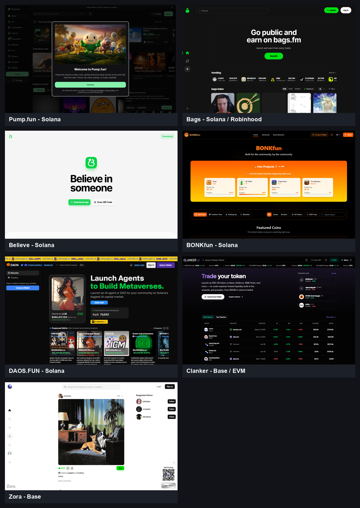

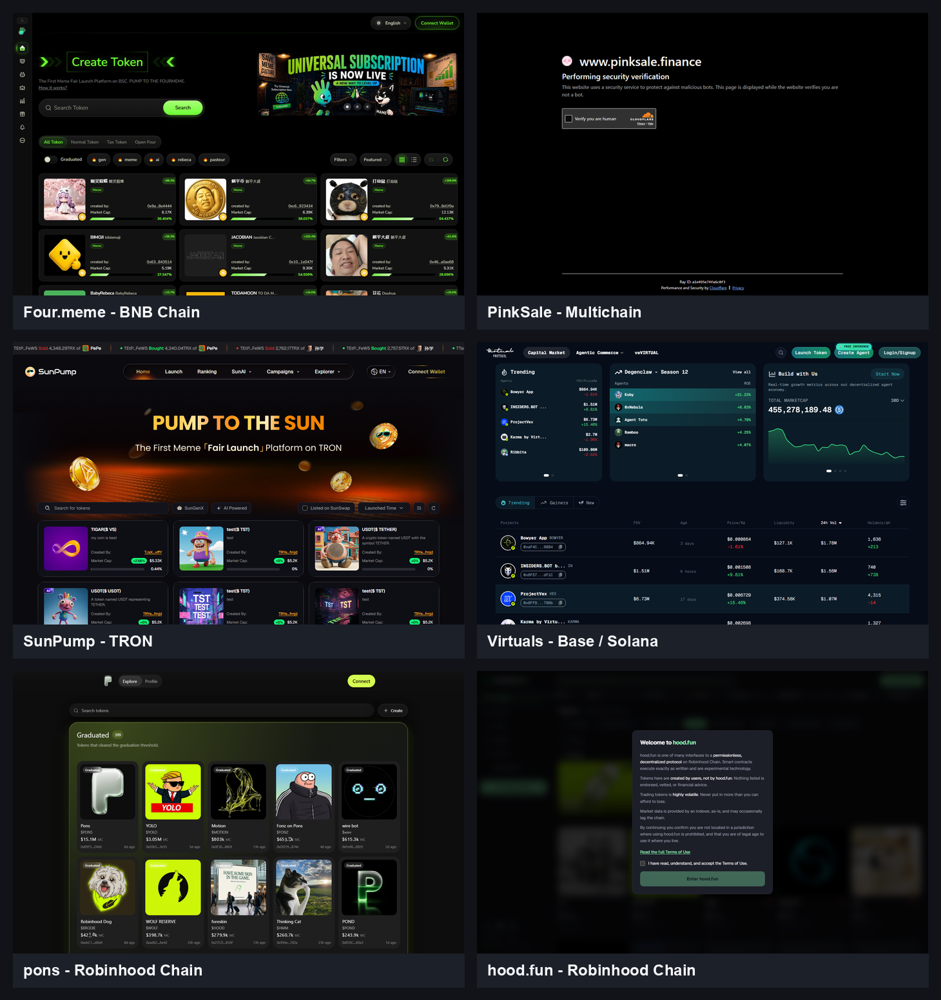

The reproducible scripts are [capture-launchpad-screenshots.mjs](../scripts/capture-launchpad-screenshots.mjs) and [build-launchpad-contact-sheets.py](../scripts/build-launchpad-contact-sheets.py). Machine-readable capture metadata is in [capture-results.json](screenshots/launchpads/capture-results.json).

## Executive findings

1. **The basic launchpad is commoditized.** Token metadata, an optional initial buy, instant price discovery, graduation, locked liquidity, a discovery grid, and a creator-fee stream are baseline features.
2. **Fee destination is becoming the product.** Pump Cashback Coins, Bags fee claimers, hood.fun Community Mode, Four.meme Tax Tokens, Clanker reward recipients, and Virtuals creator revenue all compete on who receives trading value.
3. **Our idea combines validated primitives in a new way.** The reviewed products separately prove launch automation, configurable fee routing, holder rewards, asset conversion, and purpose-specific markets. None of the reviewed interfaces exposes an immutable creator-selected basket of Stock Tokens, ETFs, crypto assets, and memecoins purchased from future creator fees.
4. **Four.meme is the closest reward-mechanics precedent.** Its Tax Tokens allow a creator to select a post-graduation tax and divide it among a wallet, holder dividends, burns, and liquidity. The parameters are locked at creation. It does not buy a custom external asset basket.
5. **hood.fun is the closest Robinhood-native holder-reward competitor.** Community Mode redirects the creator-fee share to holders pro rata. Public materials conflict on automatic delivery versus onchain claims, but either implementation overlaps our holder-reward layer.
6. **Pump is the clearest consumer precedent.** Cashback can permanently redirect some or all creator fees to eligible token users. Its interface also demonstrates that launchpads increasingly compete as content and community networks, not just deployment forms.
7. **Bags remains the best adapter candidate.** Fee sharing is a first-class configuration, its developer interface is documented, and its live homepage already exposes a Robinhood Chain market selector.
8. **Purpose beats generic positioning.** Believe sells belief in people, Zora sells posts and creators, DAOS.FUN sells agent/DAO capital formation, and Virtuals sells AI businesses. Our launchpad should sell a single purpose: launch a community token whose activity builds a visible portfolio for holders.

## Cross-platform comparison

| Platform | Chain and archetype | Launch and liquidity model | Fee or reward model | Most useful lesson for Robyn |
|---|---|---|---|---|
| [Pump.fun](https://pump.fun/) | Solana-first instant launchpad with expanding protocol surfaces | Every coin begins on a constant-product bonding curve and automatically graduates to a canonical PumpSwap pool | Curve fee is currently 1.25%, including 0.30% creator fee; Cashback mode can permanently redirect some or all creator fees to eligible users | Make the special reward mode an immutable launch-time choice and explain it in one sentence |
| [Bags](https://bags.fm/) | Solana and Robinhood Chain fee-sharing launchpad | Automated token launch and market creation with developer APIs | Fee allocation uses basis points and can support many fee earners; homepage foregrounds earning from every trade | Best upstream adapter and best precedent for treating fee routing as launch configuration |
| [Believe](https://believe.app/) | Solana creator and startup tokens | Mobile-first creator-token protocol with a minimal web landing page | Current terms describe approximately 1.398% creator, 0.599% interface, and 0.003% LP fees per trade | Strong emotional positioning and extremely simple onboarding can matter more than a dense trading terminal |
| [BONKfun](https://www.letsbonk.fun/) | Solana community memecoin launchpad | Featured bonding projects, progress indicators, and a bonded-token reward surface | Public reward page distributes a daily SOL and USD1 pool proportionally to bonded-token deployers | Progress and reward feedback can turn graduation into a game rather than a technical milestone |
| [DAOS.FUN](https://www.daos.fun/) | Solana AI-agent and DAO capital market | Creators raise SOL for agents or DAO strategies and sell tokens through an offering flow | Product emphasizes capital formation and autonomous or managed strategies rather than generic memes | A purpose-specific launchpad can justify richer onboarding and deeper project cards |
| [Clanker](https://clanker.world/) | Base and multichain EVM token launcher | Website, Farcaster, SDK, auto liquidity, creator buy, vaults, airdrops, and a short sniper-tax window | Current deploy UI presents a static 1% fee, one USDC reward recipient, and optional droid reward share | Excellent model for a serious developer surface, configurable launch modules, and data-dense discovery |
| [Zora](https://zora.co/) | Base social and creator coins | Every post is immediately tradable; profiles have Creator Coins and initial Uniswap markets | Creator/Pair coins use a 1% fee with creator, liquidity, referrals, protocol, and Doppler allocations | Hide blockchain complexity inside a familiar social feed and make creation feel like posting |
| [Four.meme](https://four.meme/) | BNB Chain bonding-curve launchpad | Free configuration, multiple possible quote assets, and graduation into PancakeSwap liquidity | Standard trading fee is 1%; Tax Tokens support 1%, 3%, 5%, or 10% post-graduation tax allocated to a wallet, holder dividends, burn, and liquidity | Closest configurable holder-reward design; our differentiator must be the external multi-asset basket |
| [PinkSale](https://www.pinksale.finance/) | Multichain presale and token-sale infrastructure | Form-driven presales rather than instant bonding-curve launches; supports many chains and project controls | Project-specific raise, sale, vesting, and liquidity settings | Shows the power and cost of configuration-heavy launch flows; our creator wizard should remain much shorter |
| [SunPump](https://sunpump.meme/) | TRON fair-launch memecoin platform | Bonding curve followed by automatic SunSwap v2 liquidity | Approximately 20 TRX creation fee and 1% curve trading fee; referrals receive a portion of trading fees | A strong hero, obvious Launch action, searchable token grid, and simple graduation status are enough for a usable MVP |
| [Virtuals](https://app.virtuals.io/) | Base and Solana AI-agent launchpad | Multiple launch types, community review, bonding curves for Pegasus/Unicorn, and long-term locked liquidity | 1,000 VIRTUAL creation fee; baseline 1% trading fee with 70% to creator and 30% to ACP incentives; dynamic launch sniper tax | Demonstrates how a specialized launchpad can add review, anti-sniper rules, and richer project quality signals |
| [pons](https://pons.money/) | Robinhood Chain instant launchpad | Fixed-supply token, Uniswap v3 pool, locked liquidity, and graduation tracking | Current documented factory split is 70% creator and 30% protocol from the 1% pool fee | Cleanest Robinhood-native discovery UI and a plausible arbitrary fee-wallet adapter if contract recipients work |
| [hood.fun](https://hood.fun/) | Robinhood Chain bonding-curve launchpad | Free launch, customizable supply, curve, graduation, swap, bridge, and community features | Creator receives 80% of fee share, or Community Mode redirects that share pro rata to holders | Direct proof that Robinhood Chain users understand fee-funded holder rewards; our basket must be immediately visible as the differentiator |

## Closest precedents to the proposed product

### 1. Four.meme Tax Tokens

Four.meme now allows a builder to select a 1%, 3%, 5%, or 10% post-graduation tax and allocate 100% of that tax among:

- A recipient wallet.
- Pro-rata holder dividends.
- Token burns.
- Added liquidity.

The configuration is locked at creation. Accumulated tax can be converted into the base asset before holder distribution, and holders can claim manually or trigger distribution through a transfer. This is strong evidence that creator-defined fee allocation and holder rewards are understandable launch settings.

What it does not provide is our central feature: splitting fees into several external assets and purchasing each asset at a creator-defined weight.

Sources: [Four.meme Tax Tokens](https://four-meme.gitbook.io/four.meme/guide/introducing-tax-tokens-on-four.meme), [Four.meme launch mechanics](https://four-meme.gitbook.io/four.meme/guide/how-it-works).

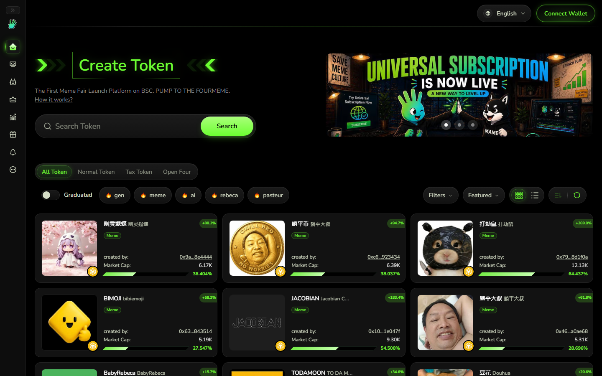

### 2. Pump.fun Cashback Coins

Pump's current creation form includes a Cash back toggle described as sending creator rewards to traders. Its terms say a Cashback Coin remains in that mode permanently and may redirect some or all creator fees to eligible users. This validates an immutable launch-time choice that sacrifices creator revenue for token-user rewards.

Pump's broader product is also much more than a launch form. Its homepage combines token discovery, communities, live content, callouts, competitions, bounties, mobile distribution, and trading tools. Robyn does not need all of this for version one, but it should plan for discovery and community loops rather than treating the launch transaction as the entire product.

Sources: [Pump creation flow](https://pump.fun/create), [Pump bonding curve](https://pump.fun/docs/bonding-curve), [Pump fees](https://pump.fun/docs/fees), [Pump Cashback terms](https://pump.fun/docs/terms-and-conditions).

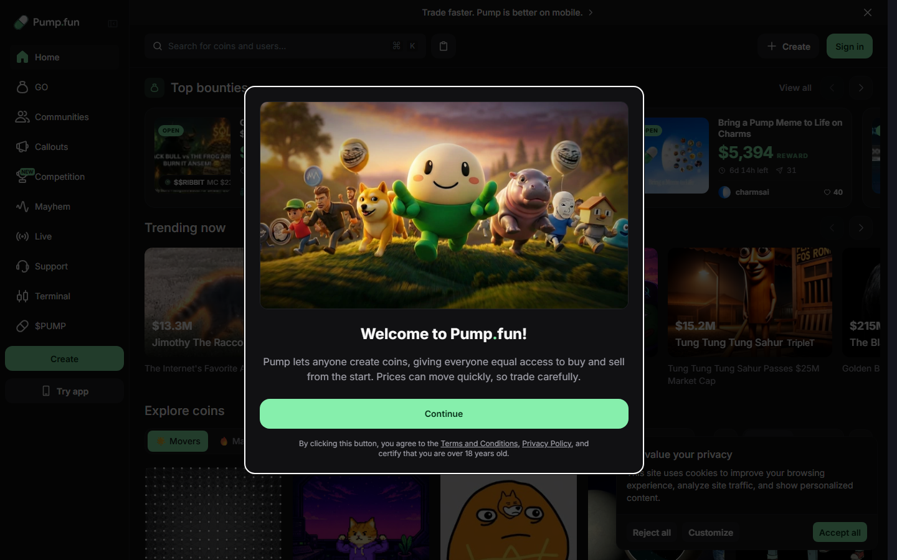

The screenshot intentionally preserves Pump's first-visit terms notice. It was not accepted on the user's behalf.

### 3. hood.fun Community Mode

hood.fun's whitepaper says Community Mode sends the creator fee share to holders pro rata. Its newer terms describe amounts as calculated and published autonomously, then claimed onchain. The delivery descriptions conflict, so deployed contracts remain the authority.

Regardless of that implementation detail, hood.fun demonstrates direct demand for the sentence "creator fees go back to holders" on Robinhood Chain. Robyn must lead with the next sentence: "and each launch chooses which assets those fees buy."

Sources: [hood.fun whitepaper](https://www.hood.fun/whitepaper), [hood.fun terms](https://hood.fun/terms).

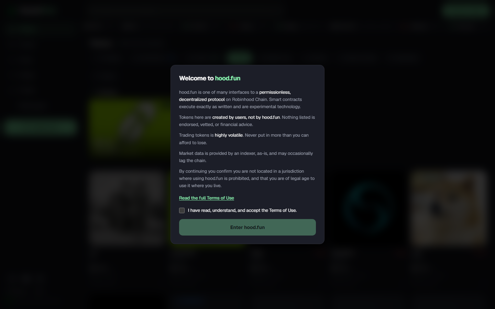

The screenshot intentionally preserves hood.fun's terms gate. It was not accepted on the user's behalf.

### 4. Bags fee sharing

Bags Token Launch v2 requires a basis-point fee configuration totaling 10,000 and documents up to 100 fee earners on Solana. It also exposes partner integration and a complete API/SDK flow. The live interface presents a minimal promise: go public and earn from every trade.

For our first implementation, the launchpad UI can call Bags while assigning the basket router as the relevant fee recipient. The exact Robinhood Chain fee-share and contract-recipient path still needs a compatibility spike; Solana API details should not be assumed to match the Robinhood deployment.

Sources: [Bags token launch and fee sharing](https://docs.bags.fm/how-to-guides/launch-token), [Bags API overview](https://docs.bags.fm/faq/what-is-bags-api).

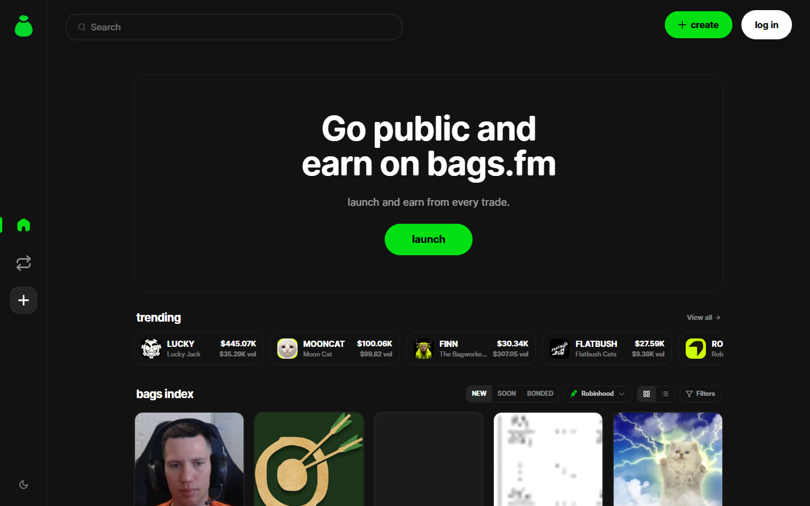

### 5. Clanker configurable launch modules

Clanker has evolved beyond a one-form deployer. Its current create flow includes chain selection, a project or USDC pool, one reward recipient, creator vesting vault, creator buy, airdrop, Farcaster launch options, an optional social droid, and a short anti-sniper tax.

The useful lesson is modularity: keep the core launch simple, then expose advanced sections without making every creator understand them. Robyn's basket selector should be the primary module; referrals, initial buys, locks, and social automation can remain secondary.

Sources: [Clanker overview](https://www.clanker.world/about), [Clanker live deploy form](https://clanker.world/deploy).

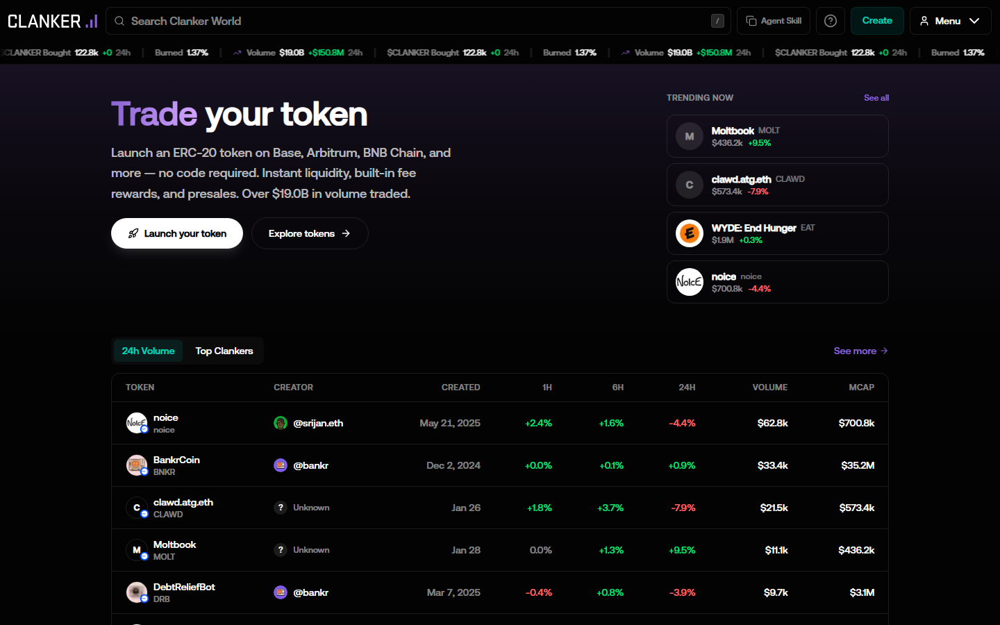

## Other product archetypes

### Social-first: Believe and Zora

Believe's web homepage is almost entirely a brand statement and mobile-app download path. Its terms describe Creator Tokens on Solana and a roughly 2% total trading fee split among creator, interface, and LP recipients. The interface sells support for a person, not token mechanics.

Zora goes further: every post is an instantly tradable coin, and every profile has a Creator Coin. Current Creator and Pair coins use a 1% fee allocated among creator rewards, liquidity deepening, platform referral, trade referral, protocol, and Doppler. The homepage is a social feed with Buy buttons rather than a launchpad grid.

Robyn should borrow their plain-language framing. A creator should feel that they are selecting what their community builds together, not configuring an investment contract.

Sources: [Believe terms](https://believe.app/terms), [Zora product overview](https://support.zora.co/en/articles/4648001), [Zora rewards](https://support.zora.co/en/articles/2509953).

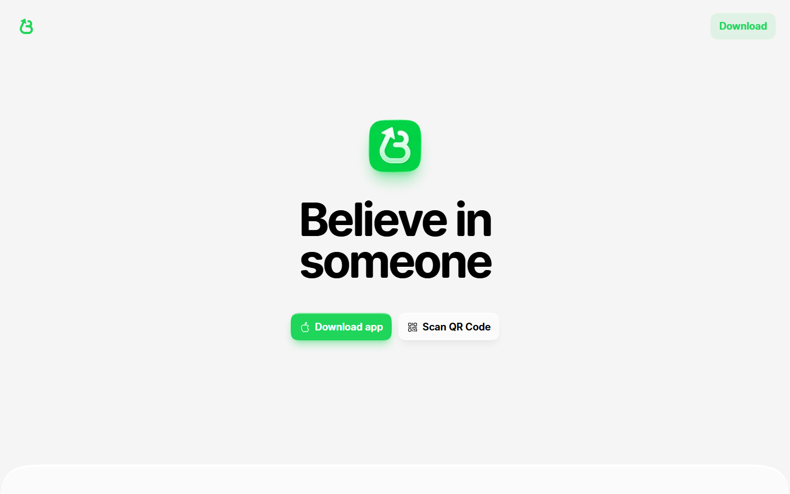

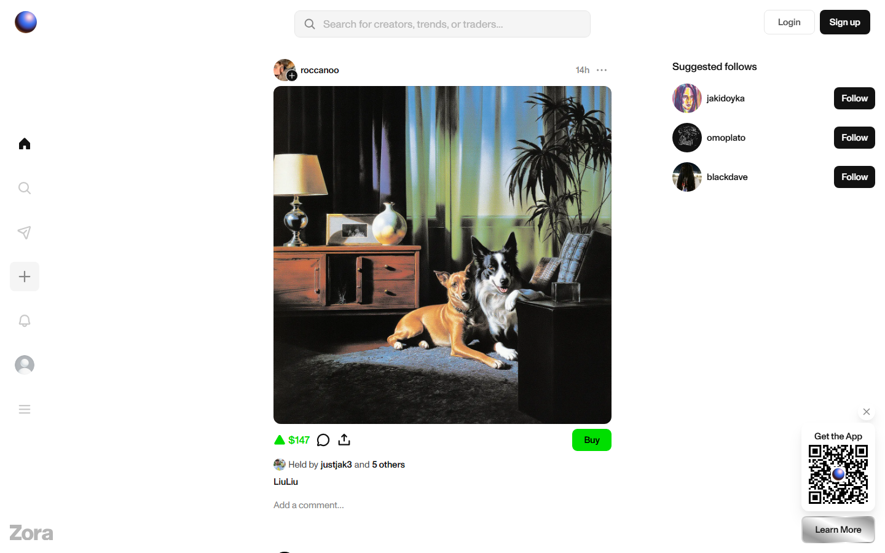

### Gamified graduation: BONKfun and SunPump

BONKfun foregrounds hot projects, bonding progress, filters, and Bond Rewards. Its separate reward page says a daily SOL and USD1 pool is distributed proportionally among qualifying bonded-token deployers. Exact current core fee allocation was not confirmed in an authoritative public document reviewed, so it should be rechecked before using BONKfun as an economic benchmark.

SunPump uses a classic fair-launch presentation: strong hero, prominent Launch action, token search, graduation filter, cards with curve progress, and live trade tape. Official docs currently describe a roughly 20 TRX creation fee, 1% platform trading fee, and automatic graduation into SunSwap v2 after the curve completes.

Sources: [BONKfun rewards](https://rewards.bonk.fun/), [SunPump launch guide](https://docs.sun.io/protocols/sunpump/concepts/how-to-launch/), [SunPump service fees](https://docs.sun.io/protocols/sunpump/concepts/service-fees/).

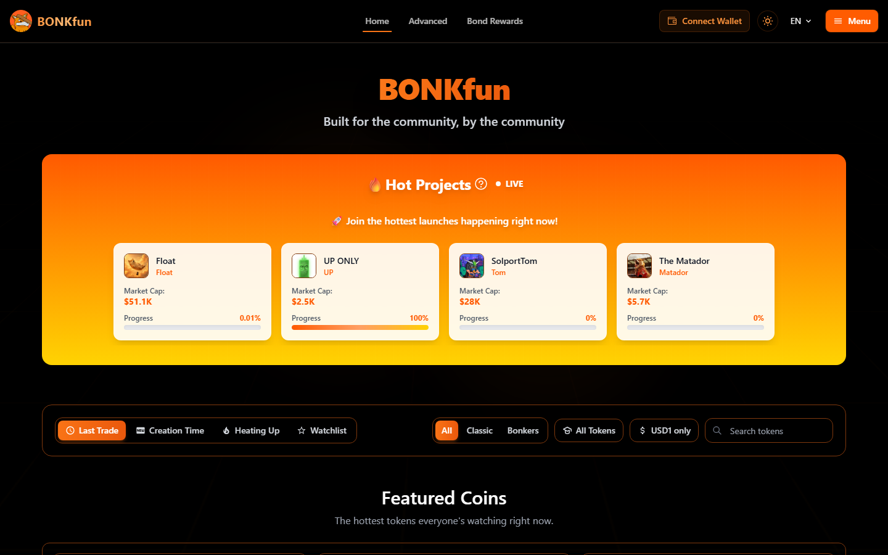

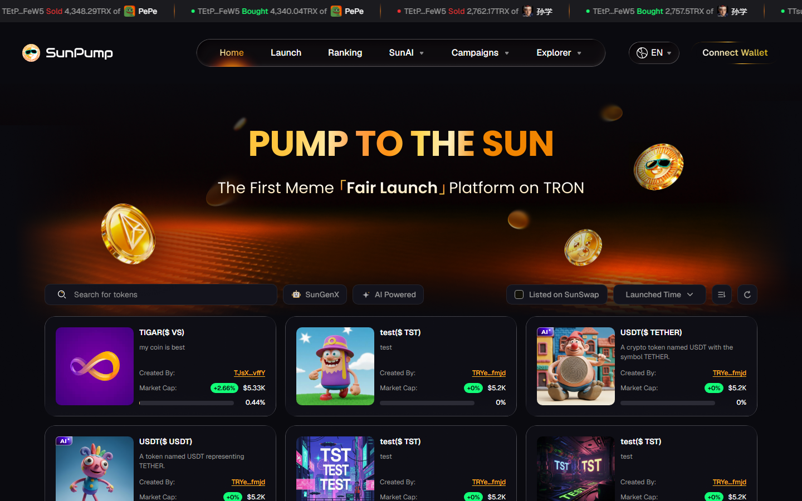

### Purpose-specific capital markets: DAOS.FUN and Virtuals

DAOS.FUN frames launches as AI agents or DAOs that raise capital for a strategy. Its homepage emphasizes featured entities and their market capitalizations rather than an undifferentiated stream of newly minted memes.

Virtuals uses Pegasus, Unicorn, and Titan launch paths. Its current documentation describes a 1,000 VIRTUAL creation fee, a community-review period for Pegasus and Unicorn, dynamic anti-sniper buy tax, a 1% baseline fee split 70% to creators and 30% to ACP incentives, graduation at 42,000 VIRTUAL liquidity, and a ten-year LP lock.

Their lesson is that a launchpad becomes defensible when it adds a shared purpose, quality signals, and post-launch activity. For Robyn, the basket itself supplies that purpose and the reward-vault history supplies the quality signal.

Sources: [DAOS.FUN](https://www.daos.fun/), [DAOS.FUN creator guide](https://docs.daos.fun/creator/overview), [Virtuals launch mechanics](https://whitepaper.virtuals.io/about-virtuals/tokenization/agent-tokenization-platform/virtuals-launch-mechanics).

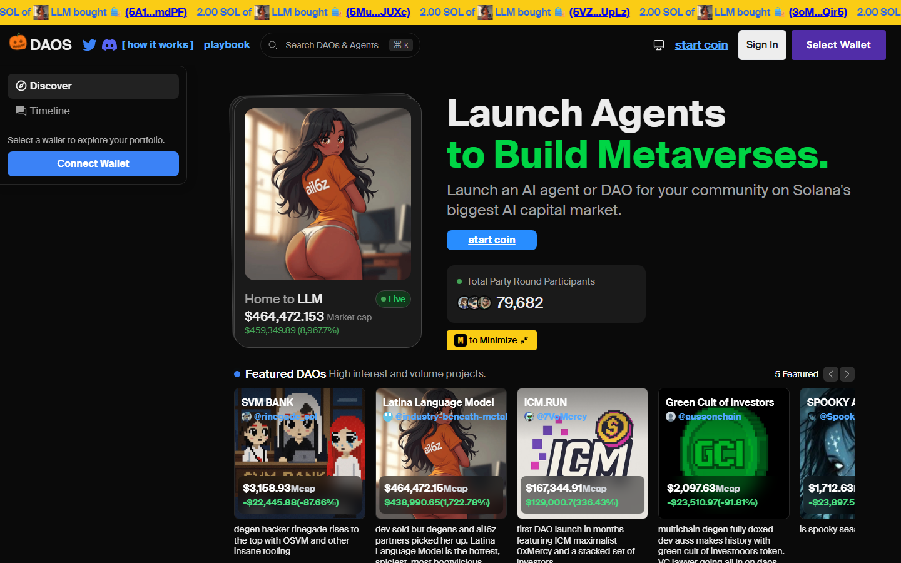

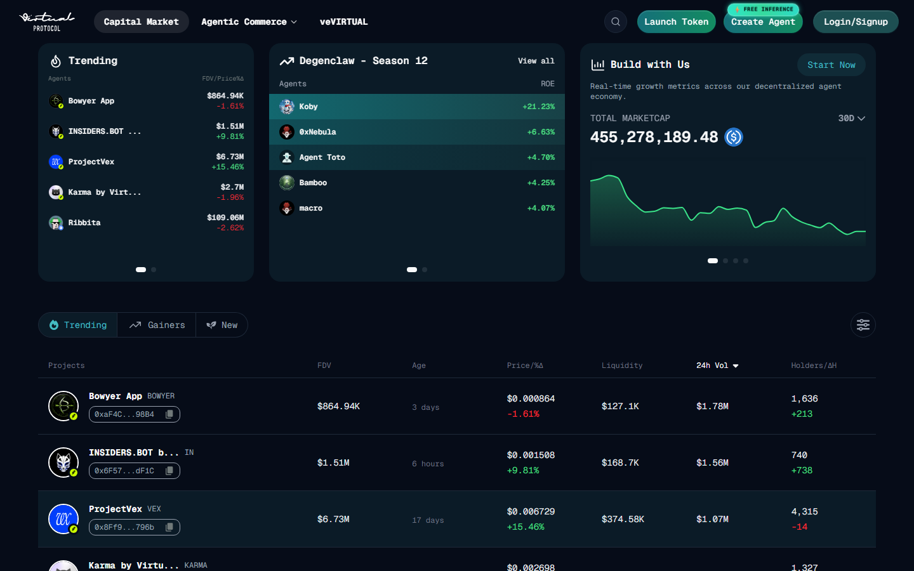

### Configuration-heavy presales: PinkSale

PinkSale represents the older multichain launchpad archetype: create a token sale, set raise parameters, manage allocations and vesting, and establish or lock post-sale liquidity. It supports many chains but requires more project setup and user trust than an instant fair launch.

The anonymous automated session was stopped by PinkSale's Cloudflare human-verification page. No CAPTCHA was attempted. The screenshot is retained because this access friction is itself a distribution and indexability consideration; product mechanics were checked through PinkSale's official documentation.

Source: [PinkSale presale guide](https://docs.pinksale.finance/launchpads/create-a-launchpad).

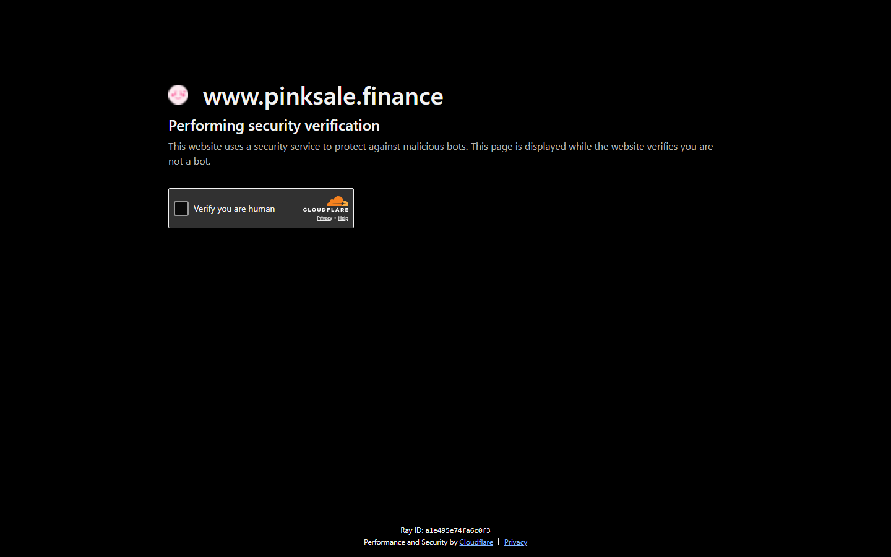

### Robinhood-native discovery: pons

pons has the cleanest Robinhood Chain launchpad presentation in the sample: search, Create, a prominent Graduated collection, and restrained token cards. Its documented token and liquidity mechanics remain a plausible adapter surface if its fee wallet can safely be a contract.

Source: [pons documentation](https://docs.ponsfamily.com/).

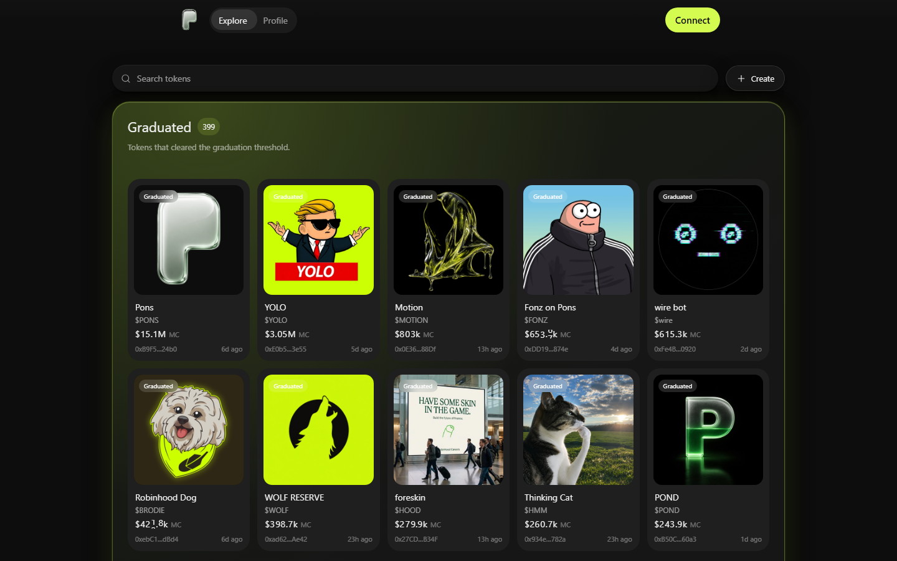

## Recommended Robyn interface

The research supports a focused interface rather than copying the largest platforms wholesale.

### Homepage

- One sentence: **Launch a coin that turns its trading fees into a portfolio for holders.**
- Primary `Create` button and wallet connection.
- Search.
- `New`, `Building`, `Graduated`, and `Most Rewards` filters.
- Token cards showing image, symbol, market cap, curve progress, 24-hour volume, and three basket badges.
- A prominent cumulative `Fees invested` value on every card.

### Creator wizard

1. Token identity and optional initial buy.
2. Select one to three canonical assets.
3. Set weights visually and numerically.
4. Preview how a sample $100 fee amount would be invested.
5. Review immutable settings, fee split, failed-asset behavior, and claim rules.
6. Launch.

### Token page

- Trade panel and curve or pool status.
- Basket composition above the fold.
- Fees awaiting harvest.
- Total purchased by asset.
- Reward vault balances.
- Connected holder's claimable amounts.
- Harvest timeline with execution price and transaction link.
- Clear badges for `Pending`, `Purchased`, `Claimable`, `Paused`, and `Held in WETH/USDG`.

### Portfolio page

- Launch tokens held.
- Rewards claimable by asset.
- Claim-all action.
- Claimed history.
- Total fee-funded portfolio value without presenting it as guaranteed yield.

## Patterns to adopt

- **Bags:** extremely clear value proposition and one dominant launch action.
- **pons:** clean graduated-token grid.
- **Pump:** strong search, navigation, and discovery loops.
- **BONKfun:** visible progress and reward gamification.
- **Clanker:** optional advanced launch modules and strong developer integration.
- **Zora:** creation and trading embedded in a familiar content interface.
- **Four.meme:** immutable allocation preview and holder-dividend controls.
- **Virtuals:** project quality signals and specialized launch categories.

## Patterns to avoid

- Hiding the actual fee destination behind generic language such as "community rewards."
- Making creators understand AMM, RFQ, oracle, or Merkle terminology.
- Showing only market capitalization while hiding fees invested and vault balances.
- Treating a single token snapshot as fair holder accounting.
- Requiring a long presale-style form for a simple launch.
- Filling the homepage with so many live feeds and modes that the primary launch action becomes secondary.
- Blocking first-time visitors before they can understand the product, unless a gate is genuinely required.

## Competitive position after this review

Robyn should not position itself as another no-code memecoin deployer. That market is saturated.

The defensible category is:

> A portfolio-building token launchpad where each launch permanently chooses which real-world and crypto assets its creator-fee stream buys for holders.

The shortest competitive explanation is:

- Pump Cashback and hood.fun prove holders understand receiving creator-fee value.
- Four.meme proves creators understand allocating transaction taxes among several destinations.
- Bags proves fee recipients can be configured at launch.
- Robinhood Chain supplies the canonical Stock Tokens and execution infrastructure.
- Robyn combines those primitives into an immutable multi-asset basket with transparent purchases and claims.
