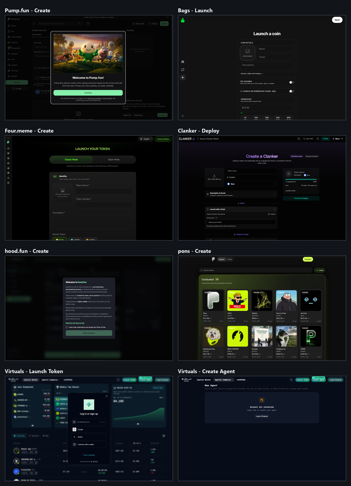
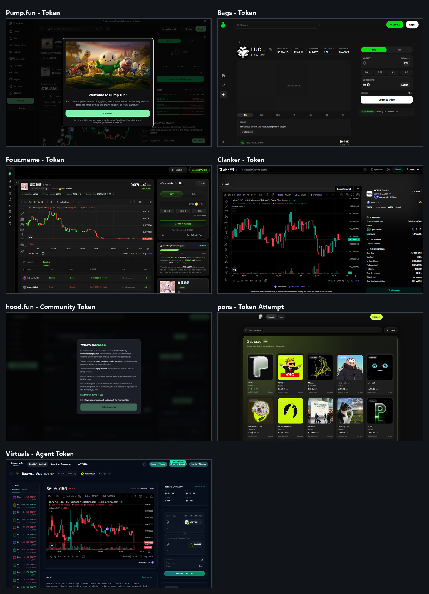
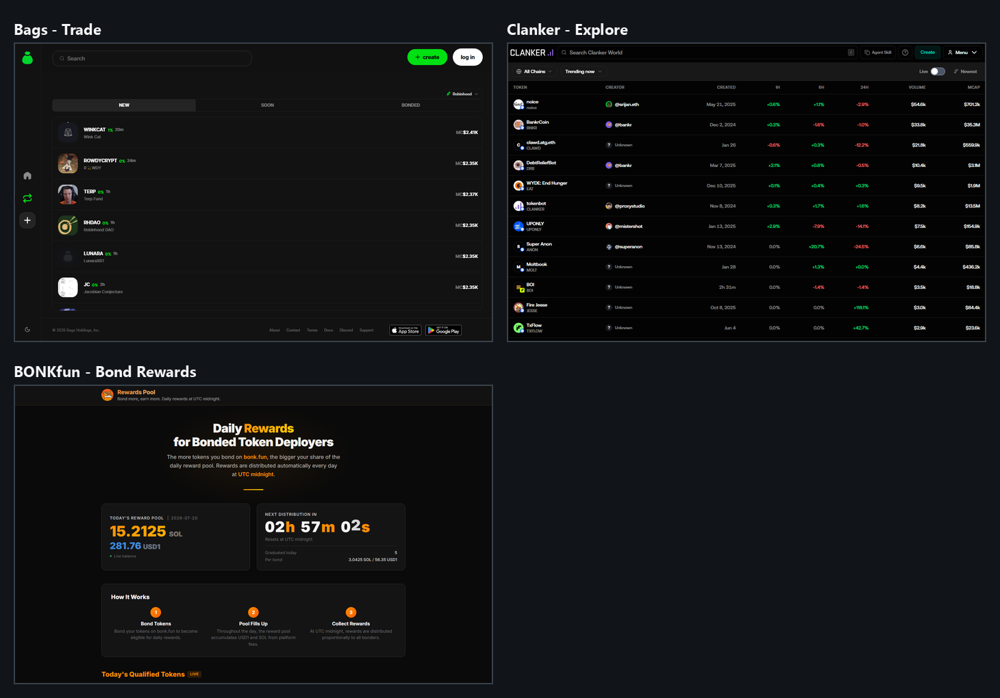
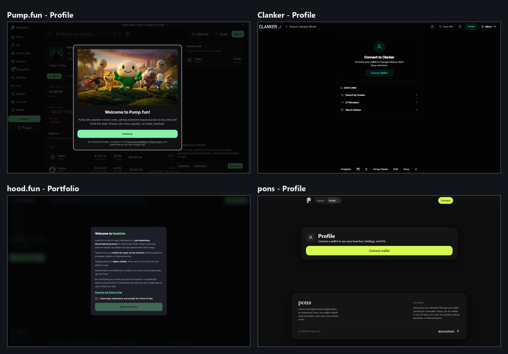

# Launchpad subpage and product-flow UX study

Last verified: 2026-07-20

## Scope

This follow-up extends the homepage comparison in [07-cross-chain-launchpad-ux-study.md](07-cross-chain-launchpad-ux-study.md). It captures 22 public, logged-out subpage states across Pump.fun, Bags, Four.meme, Clanker, hood.fun, pons, Virtuals, and BONKfun.

The review covers:

- Token and agent creation.
- Token discovery and trading.
- Token and creator detail pages.
- Profiles and portfolios.
- Fee, earnings, and rewards surfaces.
- Login, wallet, and terms gates.

No wallet was connected, no terms were accepted, no CAPTCHA was attempted, and no transaction or other external side effect was initiated. Screenshots are point-in-time evidence at 1440 by 900.

## Contact sheets

Individual captures and machine-readable metadata are in [screenshots/launchpad-subpages](screenshots/launchpad-subpages/). The reproducible scripts are [discover-launchpad-subpages.mjs](../scripts/discover-launchpad-subpages.mjs), [capture-launchpad-subpages.mjs](../scripts/capture-launchpad-subpages.mjs), and [build-launchpad-subpage-contact-sheets.py](../scripts/build-launchpad-subpage-contact-sheets.py).

## Executive findings

1. **Bags is still the closest launch-flow reference.** Its public form immediately exposes coin metadata, fee sharing, a Robinhood Chain toggle, and creator ownership without forcing login first.
2. **Four.meme and Clanker reveal complexity progressively.** Both show the complete core form while grouping advanced choices into modes, collapsible sections, or presets.
3. **Trading pages consistently use the same anatomy.** Identity and status sit at the top, the chart owns the center, buy and sell controls stay on the right, and activity or project context appears below.
4. **Earnings must be visible on the token page.** Bags exposes lifetime earnings directly. Robyn should go further by displaying fees collected, assets purchased, vault balances, and connected-holder claimables.
5. **Wallet connection should authorize actions, not explain the product.** Bags, Four.meme, and Clanker let an anonymous visitor understand the product. Pump, hood.fun, pons, and Virtuals introduce first-visit, login, or wallet gates earlier.
6. **Rewards need their own public proof surface.** BONKfun's Bond Rewards page explains eligibility, the daily pool, the next distribution, and the mechanics before wallet connection.
7. **Robinhood Chain is already treated as a selectable market.** Bags exposes a launch-chain toggle and Robinhood-filtered trade feed; Virtuals visibly labels Robinhood-native agent markets.
8. **No reviewed subpage presents our complete portfolio loop.** There is still no public competitor page that combines immutable basket weights, accrued fees, executed external-asset purchases, holder entitlement, and multi-asset claims.

## Creation-flow comparison

| Platform | Public form before authentication | Visible structure | Gate or friction | Robyn lesson |
|---|---:|---|---|---|
| [Pump.fun Create](https://pump.fun/create) | Partially | Coin details, media, preview, Mayhem, pairing and cashback options are visible behind the overlay | Mandatory first-visit continuation and separate cookie controls | Do not obscure the differentiator before visitors understand it |
| [Bags Launch](https://bags.fm/launch) | Yes | Image, name, ticker, description, social links, fee sharing, Robinhood Chain, and ownership | Login is visible but does not hide the form | Best reference for Robyn's short launch wizard |
| [Four.meme Create](https://four.meme/en/create-token) | Yes | Classic/Open mode, identity, media, description, and raised-token choice | Wallet connection is deferred | Use modes only when they materially change mechanics |
| [Clanker Deploy](https://clanker.world/deploy) | Yes | Drag-and-drop versus preset creation, identity, chain, liquidity preview, social details, droid, and token settings | Deployment requires connection, but configuration is inspectable | Best reference for optional advanced modules and live preview |
| [hood.fun Create](https://hood.fun/create) | No | Underlying page is blurred | Terms checkbox and Enter gate | Avoid a product-wide gate before the value proposition |
| [pons](https://pons.money/) | No public form in anonymous session | Create is a homepage control | Clicking Create produced no public form without a connected session | Keep Robyn creation deep-linkable and indexable |
| [Virtuals](https://app.virtuals.io/) Launch Token | No | Market remains visible behind a login dialog | Login or signup is required immediately | Explain launch types and fees before authentication |
| [Virtuals Create Agent](https://app.virtuals.io/acp/new) | Shell only | New Agent page and account state | Account not connected; login required to create | A dedicated route is useful, but the field structure should remain previewable |

### Recommended Robyn launch wizard

Use one dedicated, deep-linkable route with four compact steps:

1. **Token:** image, name, ticker, description, socials, and optional initial buy.
2. **Basket:** select one to three canonical assets, set weights, and see a $100 fee-allocation example.
3. **Economics:** show upstream fee, protocol share, holder share, harvest threshold, failed-asset behavior, and claim method.
4. **Review:** display immutable settings, contract recipients, risks, estimated wallet transactions, and Launch.

The full form should be visible without login. Connect the wallet only when the user saves a draft, validates ownership-dependent fields, or launches.

## Token-detail comparison

### Pump.fun

The token page combines identity, creator links, market capitalization, chart, trade panel, community, stats, and buy-versus-sell progress. The first-visit modal obscures the product in a fresh session, but the underlying information architecture is strong.

Capture: [pump-token-detail.png](screenshots/launchpad-subpages/pump-token-detail.png).

### Bags

The Bags token page is the strongest direct precedent for Robyn. It shows token identity, market cap, liquidity, volume, trade count, last price, a chart, buy and sell controls, graduation venue, project description, and lifetime earnings in one restrained layout.

Capture: [bags-token-detail.png](screenshots/launchpad-subpages/bags-token-detail.png).

### Four.meme

Four.meme emphasizes active trading: chart controls, buy and sell tabs, MEV protection, curve progress, quote-asset choices, comments, and trades. It is informative but denser than Robyn should be by default.

Capture: [four-token-detail.png](screenshots/launchpad-subpages/four-token-detail.png).

### Clanker

Clanker combines a professional chart with creator identity, contract address, deployment date, holder count, market cap, warnings, liquidity mechanics, and a direct trade action. It is the best reference for an advanced-information mode.

Capture: [clanker-token-detail.png](screenshots/launchpad-subpages/clanker-token-detail.png).

### hood.fun

The selected Community Mode token is inaccessible behind the same terms gate in a fresh anonymous session. This prevents prospective users from seeing the holder-reward behavior before acceptance.

Capture: [hood-community-token.png](screenshots/launchpad-subpages/hood-community-token.png).

### pons

The token cards are client-side anchors without public `href` destinations. Clicking the visible Pons card in the anonymous capture did not leave the discovery page, so there is no separately captured public token-detail route.

Capture: [pons-token-detail.png](screenshots/launchpad-subpages/pons-token-detail.png).

### Virtuals

The agent-token page combines live trades, chart, price and market-cap modes, market overview, route and slippage, an about section, and an explicit Robinhood market label. It demonstrates how a purpose-specific token can carry more context than a generic memecoin.

Capture: [virtuals-agent-detail.png](screenshots/launchpad-subpages/virtuals-agent-detail.png).

## Discovery and reward surfaces

### Bags Trade

The trade page uses `New`, `Soon`, and `Bonded` stages with a visible Robinhood selector. This is a clean precedent for Robyn's `New`, `Building`, `Graduated`, and `Most Rewards` filters.

Capture: [bags-trade.png](screenshots/launchpad-subpages/bags-trade.png).

### Clanker Explore

Clanker uses a sortable market table with chain, trend, live-update, creator, creation date, interval returns, volume, and market cap. Robyn should borrow this as an optional table view while retaining a basket-forward card view as the default.

Capture: [clanker-explore.png](screenshots/launchpad-subpages/clanker-explore.png).

### BONKfun Bond Rewards

The rewards page publicly explains the daily pool, next distribution countdown, three-step mechanics, and qualified tokens. That transparency is a strong model for Robyn's harvest and rewards-status page.

Capture: [bonk-rewards.png](screenshots/launchpad-subpages/bonk-rewards.png).

## Profiles, portfolios, and gates

| Platform | Anonymous state | Useful pattern | Missing for Robyn's use case |
|---|---|---|---|
| Pump profile | Creator holdings, created coins, value and profit/loss are visible behind first-visit overlays | Public creator track record | Basket performance and holder rewards |
| Clanker profile | Wallet-connect page names fee management and token management explicitly | Clear reason to connect | Public preview of creator launches and accrued fees |
| hood.fun portfolio | Entire surface is behind the terms gate | One destination for holdings and rewards | Public explanation and preview |
| pons profile | Simple Connect wallet state with description of launches, holdings, and profit/loss | Minimal empty state | Claimable rewards and basket holdings |

Robyn's portfolio should show a useful anonymous demo state, then reveal wallet-specific values after connection. The connected view should contain:

- Launch tokens held.
- Claimable value per reward asset.
- Claim-all and per-asset claim actions.
- Claimed history.
- Pending fee harvests.
- Failed or paused purchases.
- Total fee-funded portfolio value with no guaranteed-yield language.

## Required token-page hierarchy for Robyn

Above the fold:

1. Token identity, stage, market cap, volume, and curve or pool state.
2. Buy and sell panel.
3. Basket weights with recognizable asset symbols.
4. `Fees invested` and `Next harvest` values.
5. Connected holder's claimable balances.

Immediately below:

1. Price chart and trade history.
2. Reward-vault balances and purchase history.
3. Execution price, slippage, and transaction links for each harvest.
4. Holder accounting epoch or cumulative-index status.
5. Creator identity, immutable launch configuration, contracts, and risk disclosures.

Advanced details should be available but collapsed by default: oracle status, quote source, route, minimum output, keeper, epoch root, contract versions, and emergency state.

## Final product direction

The subpage review reinforces the earlier recommendation:

> Robyn should feel as simple to launch on as Bags, as transparent to trade on as Clanker, and as explicit about rewards as BONKfun, while making the external asset basket the visual center of every token page.

The strongest version-one flow is not a traditional presale builder. It is a public, four-step launch wizard followed by a token page where a visitor can immediately answer:

- What does this token buy with its fees?
- How much has been collected?
- What assets have actually been purchased?
- What can I claim?
- When is the next harvest?
- Are any purchases paused or held in fallback assets?
