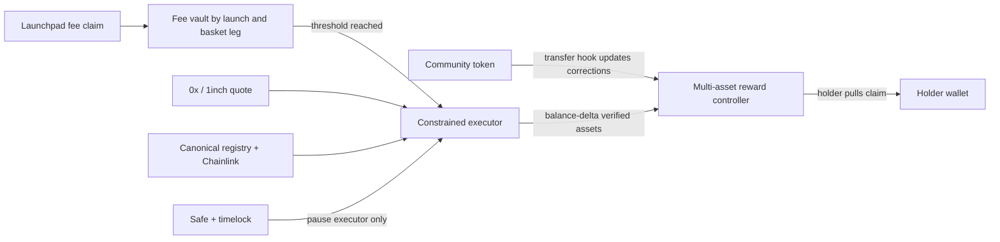

# Security, legal, operations and validation plan

Last verified: 2026-07-20

## Product boundary

The MVP is a fixed-supply community token whose trading-fee allocation buys up to three immutable, creator-selected assets and credits those assets to eligible token holders. It is **not** a redeemable basket share and should not be described as “backed by” the selected stocks.

The working launch policy remains permissionless and does not actively block US users. That is a product direction, not a legal conclusion. The interface should not falsely ask everyone to attest that they are non-US, and it should not promise universal eligibility for rights attached to Robinhood Stock Tokens. Obtain counsel on operator, issuer, broker/dealer, exchange, fund/collective-investment, derivatives, promotion, sanctions and geographic obligations before public launch.

Robinhood describes the chain as permissionless and says it does not control what third parties build. Its Chain Services terms nevertheless govern use of its RPC, sequencer, testnet, documentation and developer tools, require lawful use, and state the public RPC is not production-grade. Those terms are not a safe harbor for an application.

## Recommended contract topology

For a native token, implement one cumulative reward-per-share accumulator per asset and adjust correction balances on every transfer. A three-asset bound makes transfer gas O(3), predictable and auditable. Exclude the zero address, reward controller, pool/locker and any protocol-owned non-beneficial addresses from eligible supply.

For an adapter to an existing launch token, the token cannot update corrections on transfers. Use periodic snapshots with Merkle pull claims or require opt-in staking/wrapping. Merkle epochs preserve liquid holdings but introduce an indexer and root-publication trust surface. Staking is simpler onchain but changes the product and fragments liquidity. Never iterate over all holders onchain.

## Threat model and controls

| Threat | Required control | Verification |
|---|---|---|
| Malicious quote calldata drains approvals or changes receiver | Exact target/spender/input/output/receiver allowlists; exact approvals; balance-delta accounting | Mutation tests for every calldata field |
| Sandwiching or stale price | Expiry, min-out, Chainlink freshness/deviation and private/RFQ route where available | Fork test with manipulated AMM and stale feed |
| Thin or closed stock market | Per-leg thresholds, failure retention, explicit pending-cash state | Five-session route observation |
| Fake stock address | Snapshot only canonical live Robinhood registry addresses at launch | Reject lookalike symbol/address fixtures |
| Issuer pause, block, seize, burn or migration | Mock every issuer power; executor pause; reconciliation and recovery policy | Chaos suite and runbook drill |
| Reward insolvency | Accrue only measured post-swap balance delta; global distributed/claimed invariants | Stateful fuzz/invariant tests |
| Transfer reward theft | Magnified correction accounting before/after every mint, burn and transfer | Arbitrary action-order invariant tests |
| Rounding/dust | High-precision accumulator and carry-forward remainder | Tiny distribution and high-holder-count tests |
| Zero eligible supply | Hold reward in pending reserve, do not divide | Zero-supply and all-excluded tests |
| Reentrancy/nonstandard ERC-20 | Checks-effects-interactions, `SafeERC20`, non-reentrant claim/execution | Malicious callback and no-return-token fixtures |
| Keeper compromise | Keeper may trigger only constrained operations; no arbitrary recipient/call | Compromised-key simulation |
| Upgrade/admin compromise | Minimize upgradeability; Safe plus timelock; publish role map and event monitor | Unauthorized-call tests and tabletop recovery |
| Launchpad proxy upgrade | Pin expected implementation; monitor upgrades; pause fee claims on drift | Forked implementation-change drill |
| Snapshot/indexer omission | Two RPCs, deterministic replay, root manifest and challenge delay | Rebuild epochs independently and compare |
| Wash volume manufactures rewards | Rewards derive from fees actually paid, but manipulation may distort marketing and holder outcomes | Cohort/volume surveillance; never advertise raw volume as adoption |

## Required invariants

At all times, for each reward asset:

- total claimed is no greater than total deposited;
- controller balance plus total claimed plus explicitly reconciled issuer loss is at least total accrued, within bounded rounding dust;
- transfers do not change the sum of all wallets' withdrawable plus accumulated rewards except for rounding dust;
- a wallet cannot earn a distribution made before it acquired the community token;
- selling cannot erase already accrued rewards;
- excluded balances never dilute eligible holders;
- failed conversion does not alter basket weights;
- no privileged actor can redirect a holder's claim.

Foundry tests should include unit, fuzz, stateful invariant and mainnet-fork suites. The fork suite must cover the actual launchpad proxy implementation, canonical WETH/USDG, stock tokens, feeds and chosen exchange targets.

## Operational runbooks

### Quote or conversion failure

Pause only the affected asset route, retain funds in that leg, surface pending amount and last error, compare independent quotes, and resume only after simulation passes. Do not substitute another stock.

### Issuer token pause/block/migration

Stop new purchases, preserve accounting, identify whether claims/transfers are affected, publish an incident record, and follow the issuer's canonical migration process. No admin should confiscate unrelated reward legs.

### RPC/indexer disagreement

Stop root publication or keeper execution, compare latest finalized block hashes across providers, replay from the last agreed checkpoint, and publish only after deterministic agreement.

### Launchpad implementation upgrade

Automatically halt adapter claims when the proxy implementation changes. Review source/bytecode, rerun the compatibility suite on a fork, then explicitly approve the new implementation through Safe/timelock.

### Compromised key

Remove the keeper role through Safe, revoke exchange approvals, rotate credentials, reconcile vault/controller balances, and publish affected transaction hashes. Keeper design must make theft impossible even before rotation.

## Infrastructure budget and architecture

Keep routine RPC costs near zero by letting wallets use Robinhood's public RPC directly with multicalls, caching, request coalescing, moderate polling and jittered backoff. Shared NAT or VPN egress can still concentrate “per-user” traffic, so the UI needs a degraded mode and user-supplied RPC option.

Pay only for correctness-critical infrastructure:

- one archive-capable endpoint for complete logs and deterministic epoch rebuilding;
- a second independent low-volume provider for block/hash verification;
- authenticated 0x/1inch access for firm quotes and commercial use;
- a small keeper with no withdrawal authority;
- monitoring for implementation, role, pause, registry and balance events.

Do not put a provider or aggregator secret in browser JavaScript. Do not proxy every read through Robyn.

## Legal questions that need written answers

Send no integration to production until counsel answers, in the target operating jurisdiction:

1. Does creating and operating this interface/controller constitute issuing, arranging, brokering, operating a trading venue, managing a collective investment, or promoting a financial product?
2. Does fee-funded pro-rata receipt of Stock Tokens change that analysis compared with a creator personally receiving fees?
3. Can a smart contract or its users satisfy the Stock Token registration/product terms governing legal effectiveness of transfers and beneficial ownership?
4. What obligations arise if Robinhood/RHJ blocks, freezes, burns, migrates or refuses to recognize a transfer?
5. What sanctions screening, prohibited-jurisdiction handling, disclosures, recordkeeping and tax reporting are mandatory even for a permissionless protocol/interface?
6. Which entity operates the frontend, quote service, keeper, Safe and analytics, and which terms/privacy policy apply to each?
7. Are “rewards,” “dividends,” “index,” “stock-backed” or yield-like metrics permissible descriptions? The recommended product language avoids “backed,” “fund,” “dividend” and “APY.”

## Written integration questions

### Robinhood/RHJ

- Is permissionless contract receipt and onward distribution of each canonical Stock Token technically and contractually supported?
- Can a contract be blocked or treated as an ineligible holder, and is there a machine-readable eligibility/status interface?
- Which issuer controls may affect balances and transfers, and how are migrations announced?
- Is there a canonical testnet asset registry/faucet planned?
- May a third-party interface use registry metadata, token logos and Robinhood naming, and under what brand guidelines?

### Bags and pons

- Can a smart contract, without an EOA signature, be a fee claimer/fee wallet and complete every claim/redirect action?
- Are fee shares immutable? If mutable, who can change them and what events identify the change?
- What proxy/admin/CTO powers can change existing launches or fee rights?
- Are production integrations permitted under current terms, and is there a supported ABI/version policy?
- Is there an audit report covering the exact live implementation?

### 0x and 1inch

- Is Robinhood Stock Token execution available under commercial production terms for a permissionless frontend/keeper?
- Which routes are firm/RFQ versus indicative AMM routes, especially outside underlying market hours?
- What are API, volume, revenue-share, geographic and end-user restrictions?
- What spender/transaction targets and calldata guarantees may the contract enforce?
- What uptime, quote-expiry and incident-support commitments exist?

## User-research protocol

Interview 10 creators and 15 prospective holders using a clickable launch prototype. Do not teach the model before testing comprehension.

Creator tasks:

1. Launch a sample token with NVDA 40%, SPY 40%, and a crypto asset 20%.
2. Explain where each dollar of a hypothetical trading fee goes.
3. Respond to one unavailable asset and one thin-liquidity warning.
4. Choose between a 0.5%, 1%, 2% and 5% trading fee after seeing estimated reward flow and trader cost.
5. Explain what can and cannot change after launch.

Holder tasks:

1. Decide whether the community token is redeemable for the basket.
2. Find accrued, pending-cash and claimable amounts.
3. Explain what happens after buying immediately before or selling immediately after a distribution.
4. React to an issuer pause and a delayed conversion.
5. Estimate whether a claim is worth its gas cost.

Success criteria:

- 90% complete basket creation without help;
- 100% set weights totaling 100% or understand the validation error;
- at least 70% correctly state the token is not basket-redeemable before launch, rising to 90% after the confirmation screen;
- 80% correctly explain pending cash and failed-leg retention;
- median creator prefers a fee no higher than 2%, or provides strong evidence for a higher tier;
- at least half say weekly or slower conversion is still meaningful at expected early volume.

## Delivery gates

| Gate | Required artifact | Pass condition |
|---|---|---|
| A: accounting proof | Three-asset Foundry harness | All invariants pass, gas profiled for 1/3/5 assets |
| B: adapter proof | Bags and/or pons funded transaction record | Contract recipient completes full launch-to-claim path |
| C: execution proof | 30-day firm-quote dataset | Default asset list meets liquidity thresholds |
| D: terms proof | Written provider/launchpad answers and counsel memo | No unresolved blocker to the chosen operating model |
| E: UX proof | Interview notes and metrics | Comprehension thresholds pass |
| F: security proof | Independent audit and remediation report | No unresolved critical/high findings |
| G: operational proof | Incident drills and monitoring evidence | Recovery objectives met without holder-fund discretion |

Only after A-E should the full app be built. Mainnet beta requires F-G as well.

## Sources

- [Robinhood Chain overview](https://docs.robinhood.com/chain/)
- [Robinhood Chain Terms of Service](https://docs.robinhood.com/chain/terms-of-service/)
- [Robinhood Chain testnet/deployment guidance](https://docs.robinhood.com/chain/deploy-smart-contracts/)
- [Robinhood canonical token contracts](https://docs.robinhood.com/chain/contracts/)
- [1inch Robinhood Chain announcement](https://business.1inch.com/whats-new/robinhood-chain-support)
- [1inch Commercial API Terms](https://business.1inch.com/portal/assets/legal-docs/terms_of_service_commercial_api_20250529.pdf)
- [hood.fun terms as a current launchpad disclosure reference](https://hood.fun/terms)

This document is a research and validation plan, not legal advice or a completed audit.
