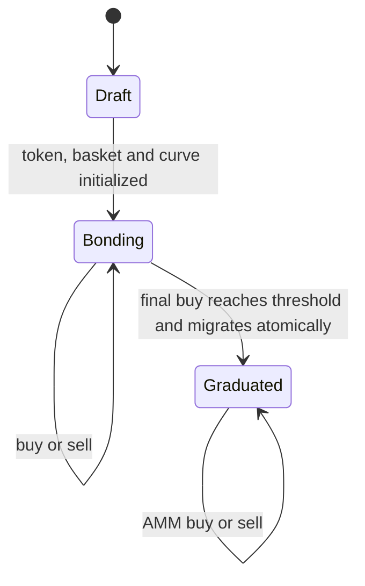

# Bonding curve and graduation design

Status: Architecture decision for controlled-devnet implementation  
Date: 2026-07-21

## Decision

Robyn will add a native launch lifecycle with a constant-product bonding curve and an automatic, irreversible graduation into locked AMM liquidity. Trading fees continue to fund the launch's immutable holder reward basket in both phases.

This is a real protocol state machine. The interface must never calculate graduation from arbitrary volume, invented market cap, or demo percentages.

## Current reference behavior

### Pump

Pump's current documentation describes a virtual-reserve constant-product AMM. Buys move the price upward, sells move it downward, and price impact grows with order size. Completion closes the curve and moves liquidity atomically to PumpSwap. Migration is irreversible and the protocol owns the canonical pool liquidity.

Primary sources:

- https://pump.fun/docs/bonding-curve
- https://pump.fun/docs/fees
- https://github.com/pump-fun/pump-public-docs/blob/main/docs/PUMP_PROGRAM_README.md

### Circus

The live Circus product currently presents two launch lanes. Its Classic Curve lane uses a 1B fixed supply, offers 800M on the curve, shows market cap and graduation progress on cards and token pages, and states that graduation occurs at roughly 6.5 ETH raised. Its published explanation says graduation atomically creates a Uniswap v3 pool and locks liquidity permanently. Its Fair Open lane starts directly in a locked Doppler/Uniswap v4 pool and has no graduation phase.

Live references:

- https://circus.trade/
- https://circus.trade/how-it-works

Point-in-time observations can drift. Contract source and deployment provenance must be independently verified before reusing any external implementation.

## Robyn lifecycle

| Phase | Trading venue | Pricing | Liquidity status | Reward fees |
|---|---|---|---|---|
| Draft | None | None | Not initialized | None |
| Bonding | Robyn curve | Constant product with virtual reserves | Curve inventory and reserve held by immutable market | Routed to the immutable basket vault |
| Graduated | Canonical AMM pool | Pool reserves | LP position permanently locked | Pool fee share routed to the same basket vault |

## Controlled-devnet policy

- Fixed token supply: 1,000,000,000 tokens.
- Curve allocation: 800,000,000 tokens.
- Graduation-liquidity allocation: 200,000,000 tokens.
- Quote asset: mock USD (`mUSD`).
- Curve formula: `virtualTokenReserve * virtualBaseReserve = k` with conservative rounding.
- Trade fee: 1.00%, routed into the existing weighted reward vault.
- Graduation target: 6,500 mUSD net curve reserve for normal devnet launches.
- Accelerated test fixtures may use a smaller constructor target, but the UI must display the actual immutable target read from the market.
- Graduation: automatic in the threshold-reaching buy, atomic, idempotent and irreversible. No keeper or follow-up transaction is required.
- Local graduated venue: an immutable no-withdrawal constant-product pool that implements the same fee-vault interface. It is a rehearsal dependency, not a claim that Uniswap is running locally.

Exact production virtual reserves must be chosen by a checked-in economic simulation that proves the starting FDV, terminal curve price, migration price continuity, maximum price impact and reserve solvency. The initial controlled-devnet constants are test parameters, not a mainnet recommendation.

## Required contract boundaries

### `BondingCurveMarket`

- Immutable token, quote asset, reward vault, curve parameters, fee and graduation adapter.
- Holds only the curve allocation and curve quote reserve.
- Exposes exact buy/sell quotes, current price, net reserve, remaining curve inventory, progress basis points and lifecycle phase.
- Applies checks-effects-interactions and reentrancy protection.
- Rejects zero amounts, zero-output trades, impossible reserve states, stale minimum outputs and trades after curve closure.
- Emits reserve snapshots after every trade so the indexer can reproduce price history without guessing.

### `DevnetLockedLiquidityPool`

- Is pre-created for one market and can be initialized only once by that market during the threshold-reaching buy.
- Receives exactly the recorded quote reserve, remaining curve inventory and reserved graduation allocation.
- Holds the resulting liquidity without an owner, admin or withdrawal path.
- Binds the pool fee receiver to the existing launch reward vault.
- Records the venue, pool, locker, migrated amounts and transaction in one canonical event.
- Does not accept arbitrary tokens, recipients, routers, fee tiers or price ranges at initialization time.

### Launch token

- Fixed supply and no post-launch mint authority.
- Ordinary ERC-20 transfers remain enabled in both phases, matching the expected wallet and reward-accounting behavior of launchpad tokens.
- The Robyn market is the only protocol-created trading venue before graduation; the protocol does not create or endorse side liquidity.
- Reward correction accounting remains solvent across transfers and the venue transition.

## Invariants

1. Quote reserves and curve inventory never become negative.
2. Every successful trade preserves the constant-product invariant within documented conservative rounding.
3. Actual token and quote balances cover all recorded reserves and pending fee transfers.
4. Net reserve and progress decrease correctly after sells and never exceed 10,000 bps in the public view.
5. Graduation cannot occur below the threshold or in a transaction separate from the threshold-reaching buy.
6. Graduation can succeed only once and cannot be reversed.
7. No privileged account can withdraw curve or graduated liquidity.
8. The migrated amounts exactly equal the curve's recorded migratable balances.
9. Trading fees before and after graduation remain isolated to the launch's existing basket vault.
10. Buyers after a prior reward distribution cannot receive that prior reward.
11. Failed graduation leaves the complete curve state recoverable and does not strand user balances.
12. A malicious token, router, adapter or callback cannot reenter trade, fee recording or migration.

## API and indexing

Every discovery and token-detail response must expose:

- `marketPhase`: `bonding`, `graduated` or `legacy_fixed`;
- current price and market cap;
- `graduationProgressBps`;
- net quote reserve and immutable graduation target;
- remaining curve tokens;
- graduated pool and locker addresses when present;
- formula and adapter version;
- block number for the indexed snapshot.

The indexer derives history from canonical curve-state and graduation events. It must not estimate progress from volume because sells, fees and failed transactions make gross volume an invalid reserve proxy.

## Product behavior

- Discovery cards show both the reward-basket weight rail and a compact graduation rail. They answer different questions and neither replaces the other.
- The token page shows phase, current progress, amount raised, amount remaining, curve price, estimated price impact, migration destination and locked-liquidity proof.
- Buy/sell controls quote the active venue and refresh after each confirmed transaction.
- A graduated token visibly switches from `Bonding` to `Graduated`, links the pool and lock receipt, and never continues showing a mutable progress bar.
- Discovery supports `Bonding` and `Graduated` filters.
- Creation previews fixed supply, curve allocation, migration allocation, threshold, fee routing and the automatic migration behavior before signature.

## Delivery sequence

1. Add economic simulation and select controlled-devnet parameters.
2. Implement curve, local graduation pool and adversarial tests.
3. Extend deployment manifest, verifier, indexer and read API.
4. Extend create, discovery, detail, trade and portfolio interfaces.
5. Deploy a new controlled-devnet factory without deleting the current chain or user-created launches; retain legacy fixed-market reads during migration.
6. Exercise an accelerated launch through buy, sell, threshold, graduation, post-graduation trade, fee conversion and holder claim in the in-app browser.
7. Before Robinhood testnet, verify the exact Uniswap/Doppler deployment, fee ownership, pool initialization, locker and price-range strategy, then replace the local adapter.

## Implemented controlled-devnet status

Last verified 2026-07-21:

- `DevnetBondingCurveMarket` implements exact buy/sell quotes, the 1% basket fee, reserve-derived progress, final-buy refund and automatic graduation.
- `DevnetLockedLiquidityPool` is a one-market, initialize-once constant-product venue with no owner or liquidity-withdrawal function. It is strictly a local rehearsal for a production AMM plus immutable locker.
- `DevnetMarketFactory` at `0x367761085BF3C12e5DA2Df99AC6E1a824612b8fb` creates the curve and its pre-bound graduated pool. The prior fixed-price factory remains readable as a legacy venue.
- The canonical bonding fixture is CURVE at `0x332c7fbc5c4ecc9867f845476f4a264e685bdf71`; the canonical graduated fixture is GRAD at `0xc17e182b5839cabef427df32c4e11b86b6d7ba39`.
- The full Foundry suite passes 29 tests, including four stateful invariants at 128 runs each. Browser acceptance covered permissionless creation, curve quoting and buying, progress changes, automatic graduated-state rendering, locked-pool disclosure and post-graduation quoting.
- Robinhood testnet release still requires a separately verified production adapter that binds the exact supported AMM pool, initialization parameters, fee ownership and immutable LP locker. The local pool is not that adapter.

## Explicit non-shortcuts

- Do not label gross volume as amount raised.
- Do not show fabricated graduation percentages.
- Do not mark a token graduated from an offchain admin flag.
- Do not let a keeper choose migration recipients or assets.
- Do not call an unlocked or admin-withdrawable position `locked liquidity`.
- Do not reuse Pump or Circus contracts without verified source, license, deployment provenance and an independent security review.
